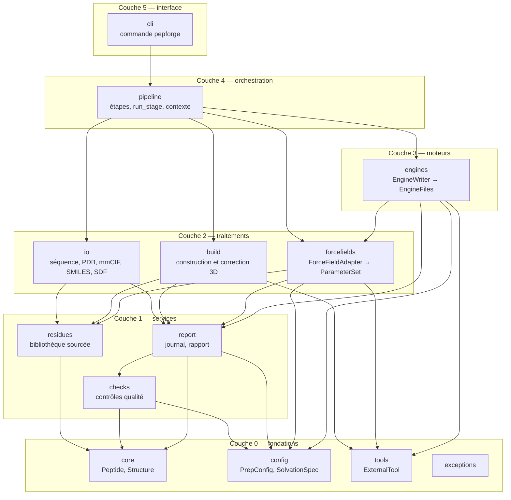
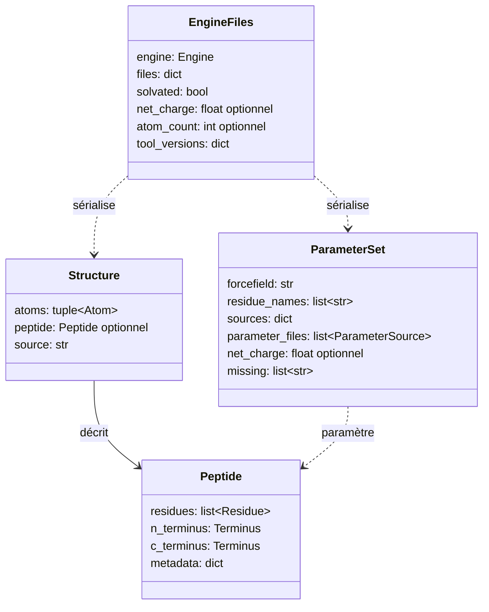
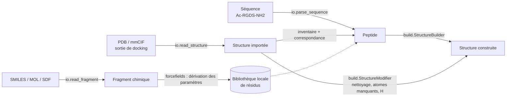
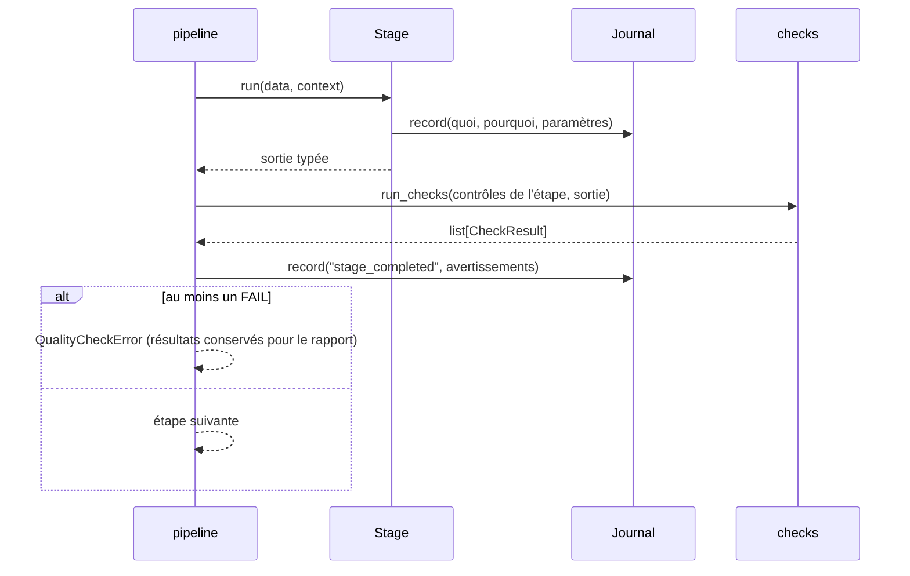
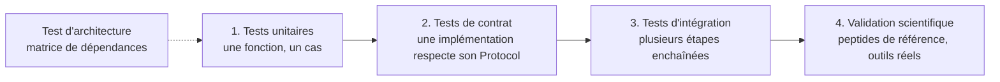
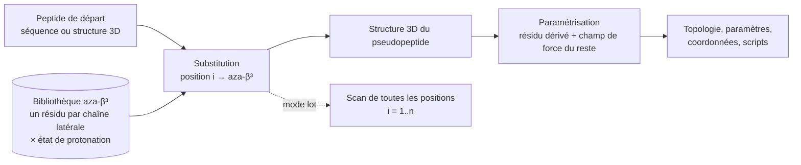

# PepForge — Architecture

> Document de référence de l'architecture. Il décrit les modules, ce que chacun a le droit de connaître, les types de données qu'ils échangent, l'enchaînement du pipeline, et la façon dont chaque étape est revue, contrôlée et testée.
>
> Le plan de construction étape par étape est dans [PLAN-CONSTRUCTION.md](PLAN-CONSTRUCTION.md). Les règles de développement sont dans [`CLAUDE.md`](../CLAUDE.md).

## Sommaire

1. [Principes](#1-principes)
2. [Vue d'ensemble des modules](#2-vue-densemble-des-modules)
3. [Règles de dépendance](#3-règles-de-dépendance)
4. [Types de données échangés](#4-types-de-données-échangés)
5. [Contrat de chaque module](#5-contrat-de-chaque-module)
6. [Flux du pipeline](#6-flux-du-pipeline)
7. [Vérification : revue, contrôles et tests](#7-vérification--revue-contrôles-et-tests)
8. [Modifier un module isolément](#8-modifier-un-module-isolément)
9. [Décisions ouvertes et compromis](#9-décisions-ouvertes-et-compromis)
10. [Cas d'usage central : substitution aza-β³](#10-cas-dusage-central--substituer-un-acide-aminé-par-un-résidu-aza-β³)

---

## 1. Principes

| # | Principe | Conséquence concrète |
|---|---|---|
| P1 | **Un module, une responsabilité** | Chaque dossier de `src/pepforge/` a un rôle unique (section 5). |
| P2 | **Les modules ne se parlent que par des types déclarés** | Les échanges passent par les types de la section 4 (`Peptide`, `Structure`, `ParameterSet`, `EngineFiles`...). Aucun dictionnaire « fourre-tout ». |
| P3 | **Les dépendances vont dans un seul sens** | Une matrice autorise ou interdit chaque import (section 3). Elle est vérifiée par `tests/test_architecture.py` : un import interdit fait échouer la CI. |
| P4 | **Les interfaces sont des `Protocol`** | Un adaptateur, un moteur, un constructeur ou une étape se remplace sans toucher au reste, tant qu'il respecte son `Protocol` et passe ses tests de contrat (`tests/contracts.py`). |
| P5 | **Chaque étape est contrôlée à sa sortie** | `pipeline.run_stage` exécute l'étape, puis ses contrôles (`checks`) ; un contrôle en échec arrête tout (`QualityCheckError`). |
| P6 | **Rien n'est supposé** | Moteur, champ de force, modèle d'eau, objectif, pH, solvatation : aucune valeur par défaut (`PrepConfig`, `SolvationSpec`). Aucun paramètre numérique codé en dur : les données viennent de fichiers sourcés. |
| P7 | **Tout est tracé** | Chaque modification de structure est journalisée (`Journal`), chaque outil externe enregistre sa version, chaque contrôle laisse un résultat dans le rapport. |
| P8 | **Indépendance vis-à-vis du champ de force et du moteur** | `core`, `io`, `residues`, `build` et `checks` ne connaissent aucune nomenclature de champ de force (`NHE`, `HIE`...) ni aucun format moteur (`.prmtop`, `.top`, `.psf`). |

---

## 2. Vue d'ensemble des modules

Les flèches indiquent « importe ». Toutes les couches peuvent importer `exceptions` (non dessiné pour la lisibilité). Une flèche ne remonte jamais vers une couche supérieure.

| Module | Rôle | État |
|---|---|---|
| `exceptions` | Hiérarchie d'exceptions dédiées (`PepForgeError` et dérivées) | en place |
| `core` | Représentation interne : `Peptide`, `Residue`, `Terminus`, `Structure`, `Atom` | `Peptide` en place, `Structure` minimale |
| `config` | `PrepConfig`, `SolvationSpec`, `Engine`, `SimulationGoal` ; YAML aller-retour | en place |
| `tools` | `ExternalTool` : exécutable externe, version, détection d'échec dans la sortie | en place |
| `residues` | Bibliothèque de résidus et d'extrémités chargée depuis `residues/data/*.yaml`, avec provenance | acides aminés standards et extrémités usuelles |
| `checks` | Contrôles qualité : fonctions pures `sortie d'étape → CheckResult` | socle + 2 contrôles sur `Peptide` |
| `report` | `Journal` des opérations ; rapport de préparation reproductible | journal en place, rapport à écrire |
| `io` | Lecture et écriture : séquences, puis PDB, mmCIF, SMILES, MOL/SDF | séquences en place |
| `build` | Construction 3D depuis un `Peptide`, corrections d'une `Structure` | interfaces seulement |
| `forcefields` | Adaptateurs de champ de force → `ParameterSet` | interface seulement |
| `engines` | Écriture des fichiers d'un moteur, solvatation | interface seulement |
| `pipeline` | `Stage`, `StageContext`, `run_stage`, étapes concrètes | socle + étape « séquence » |
| `cli` | Commande `pepforge` | `parse`, `config-template` |

---

## 3. Règles de dépendance

Matrice des imports internes autorisés. La source de vérité exécutable est le dictionnaire `ALLOWED` de [`tests/test_architecture.py`](../tests/test_architecture.py) : les deux doivent rester identiques.

| Module ↓ peut importer → | exceptions | core | config | tools | residues | checks | report | io | build | forcefields | engines | pipeline |
|---|---|---|---|---|---|---|---|---|---|---|---|---|
| **exceptions** | — | | | | | | | | | | | |
| **core** | ✓ | — | | | | | | | | | | |
| **config** | ✓ | | — | | | | | | | | | |
| **tools** | ✓ | | | — | | | | | | | | |
| **residues** | ✓ | ✓ | | | — | | | | | | | |
| **checks** | ✓ | ✓ | ✓ | | | — | | | | | | |
| **report** | ✓ | ✓ | ✓ | | | ✓ | — | | | | | |
| **io** | ✓ | ✓ | | | ✓ | | ✓ | — | | | | |
| **build** | ✓ | ✓ | | ✓ | ✓ | | ✓ | | — | | | |
| **forcefields** | ✓ | ✓ | ✓ | ✓ | ✓ | | ✓ | | | — | | |
| **engines** | ✓ | ✓ | ✓ | ✓ | | | ✓ | | | ✓ | — | |
| **pipeline** | ✓ | ✓ | ✓ | ✓ | ✓ | ✓ | ✓ | ✓ | ✓ | ✓ | ✓ | — |
| **cli** | ✓ | ✓ | ✓ | | | ✓ | ✓ | ✓ | | | | ✓ |

Points essentiels :

- **`io`, `build` et `forcefields` ne se connaissent pas.** Ils sont reliés uniquement par `pipeline`, à travers les types de `core`. On peut donc remplacer le constructeur 3D sans toucher aux champs de force, et inversement.
- **`forcefields` n'importe jamais `engines`.** Un adaptateur produit des paramètres, il n'écrit pas de fichier moteur (règle 2 de `CLAUDE.md`). `engines` importe `forcefields` uniquement pour le type `ParameterSet`.
- **`tools` est une feuille.** `ExternalTool` est utilisé par `build`, `forcefields` et `engines` ; s'il était resté dans `pipeline`, ces modules auraient dû importer leur propre orchestrateur, ce qui crée une dépendance circulaire. C'est pourquoi il a été déplacé de `pepforge.pipeline.external` vers `pepforge.tools.external`.
- **`cli` ne contient aucune logique scientifique.** Il lit les arguments, appelle `pipeline` (ou `io` pour les commandes d'inspection) et affiche.
- Les imports relatifs (`from .x import y`) sont interdits, pour que la matrice reste vérifiable.

Le test vérifie aussi que la matrice ne contient pas de cycle, et que tout nouveau module y est déclaré.

---

## 4. Types de données échangés

Ce sont les seuls objets qui traversent les frontières entre modules. Chaque type appartient à un module unique, qui seul le modifie.

| Type | Module propriétaire | Produit par | Consommé par | Invariants |
|---|---|---|---|---|
| `PrepConfig` | `config` | utilisateur (YAML), `cli` | `pipeline`, `checks`, `report` | Aucun champ décisionnel n'a de valeur par défaut. `missing_decisions()` liste ce qui manque. Aller-retour YAML sans perte. |
| `SolvationSpec` | `config` | `PrepConfig.solvation` | `engines` | Aucune valeur par défaut ; vérifié par l'étape de solvatation. |
| `Peptide` | `core` | `io` (séquence, structure), `build` (mutation) | `build`, `forcefields`, `checks` | Extrémités N et C toujours explicites ; une extrémité par défaut est signalée dans `metadata`. Aucun nom propre à un champ de force. |
| `Residue`, `Terminus` | `core` | `residues` | tous | Immuables ; identifiants internes stables (`amide`, `acetyl`...). |
| `Structure`, `Atom` | `core` | `io` (PDB, mmCIF), `build` | `build`, `engines`, `checks` | Immuables ; coordonnées en Å ; nomenclature PDB, jamais celle d'un champ de force. |
| `ResidueLibrary` | `residues` | `residues.load_default_library()` | `io`, `build`, `forcefields` | Chaque fichier chargé déclare sa source (`sources`). |
| `ParameterSet`, `ParameterSource` | `forcefields` | un `ForceFieldAdapter` | `engines`, `checks`, `report` | `missing` vide avant toute écriture moteur ; `sources` non vide. |
| `EngineFiles` | `engines` | un `EngineWriter` | `pipeline`, `checks`, `report` | Charge nette et nombre d'atomes **relus** dans les fichiers produits, pas recopiés de l'entrée ; versions des outils présentes. |
| `ToolResult` | `tools` | `ExternalTool.run()` | `build`, `forcefields`, `engines` | Version de l'outil renseignée ; une sortie contenant un motif d'échec lève `ExternalToolError`. |
| `JournalEntry`, `Journal` | `report` | tout composant qui modifie une structure, `run_stage` | `report` | Ajout seulement, jamais de suppression. |
| `CheckResult` | `checks` | `Check` | `pipeline`, `report` | `FAIL` arrête le pipeline ; `WARN` est reporté dans le rapport. |
| `StageContext` | `pipeline` | `pipeline` | les étapes | Contient `config`, `journal`, `workdir`, résultats des contrôles. |

---

## 5. Contrat de chaque module

Pour chaque module : ce qu'il reçoit, ce qu'il rend, les erreurs qu'il lève, et ce qu'il ne doit jamais faire.

### 5.1 `core` — représentation interne

- **Entrées / sorties** : aucune entrée externe ; fournit `Peptide`, `Residue`, `Terminus`, `Structure`, `Atom`.
- **Ne fait jamais** : lire un fichier, connaître un champ de force ou un moteur, contenir une constante physique.
- **Évolutions prévues** : états de protonation par résidu, modifications de chaînes latérales, liaisons non linéaires (ponts disulfure, cyclisation), plusieurs chaînes (complexe).

### 5.2 `config` — configuration d'une préparation

- **Entrées** : dictionnaire ou fichier YAML. **Sorties** : `PrepConfig`.
- **Erreurs** : `ConfigurationError` (clé inconnue, valeur invalide, décision manquante via `require_complete()`).
- **Garantie** : le YAML écrit par le rapport suffit à relancer la préparation (règle 8).

### 5.3 `tools` — exécutables externes

- **Entrées** : nom de l'exécutable, arguments, motifs d'échec. **Sorties** : `ToolResult`.
- **Erreurs** : `ExternalToolError` (exécutable absent, code de retour non nul, motif d'échec dans la sortie).
- **Garantie** : la version est toujours enregistrée ; le code de retour seul ne suffit pas (tleap retourne 0 même en cas de paramètre manquant).

### 5.4 `residues` — bibliothèque sourcée

- **Entrées** : fichiers `residues/data/*.yaml`, chacun avec un champ `source`. **Sorties** : `ResidueLibrary`.
- **Erreurs** : `UnknownResidueError`, `UnknownTerminusError`.
- **Ne fait jamais** : contenir des paramètres de champ de force (ceux-ci vivent dans `forcefields/data/`). Contiendra des données chimiques sourcées : états de protonation, pKa de référence avec leur publication.

### 5.5 `checks` — contrôles qualité

- **Entrées** : la sortie d'une étape (`Peptide`, `Structure`, `ParameterSet`, `EngineFiles`). **Sorties** : `CheckResult` (`PASS`, `WARN`, `FAIL`).
- **Règles** : un contrôle est une fonction pure, sans effet de bord ni appel externe ; il référence l'item de [04-checklist-qualite.md](04-checklist-qualite.md) qu'il couvre (`checklist_item`).
- **Ne fait jamais** : décider d'arrêter le pipeline (c'est `pipeline.run_stage` qui le fait) ni corriger ce qu'il constate.

### 5.6 `report` — journal et rapport

- **Entrées** : opérations (`Journal.record`), résultats de contrôles, `PrepConfig`, versions d'outils. **Sorties** : journal YAML, rapport de préparation, configuration rejouable.
- **Garantie** : un rapport contient tout ce qu'il faut pour refaire la préparation à l'identique.

### 5.7 `io` — lecture et écriture

- **Entrées** : texte (séquence), fichiers PDB, mmCIF, SMILES, MOL/SDF. **Sorties** : `Peptide`, `Structure` (et, pour le mode « structure personnalisée », un fragment chimique à définir à l'étape 11 du plan).
- **Erreurs** : `SequenceParseError`, `UnknownResidueError`, `UnknownTerminusError`, `StructureError`.
- **Ne fait jamais** : corriger silencieusement une structure lue. Toute correction est un `StructureModifier` de `build`, journalisé.

### 5.8 `build` — construction et correction 3D

- **Interfaces** : `StructureBuilder.build(peptide, journal) -> Structure` ; `StructureModifier.apply(structure, journal) -> Structure`.
- **Erreurs** : `StructureError`, `ChemistryError`.
- **Garanties** : structure d'entrée jamais modifiée sur place ; extrémités conservées ; chaque transformation journalisée.
- **Ne fait jamais** : utiliser une nomenclature de champ de force.

### 5.9 `forcefields` — adaptateurs de champ de force

- **Interface** : `ForceFieldAdapter` avec `name`, `supported_engines`, `compatible_water_models`, `parametrize(peptide) -> ParameterSet`.
- **Erreurs** : `MissingParameterError` dès qu'un paramètre manque ; `ConfigurationError` pour un modèle d'eau incompatible.
- **Données** : `forcefields/data/` (correspondances de noms de résidus, fichiers à charger), chacune avec sa source.
- **Ne fait jamais** : écrire un fichier moteur, inventer un paramètre, substituer `NME` à `NHE`.

### 5.10 `engines` — fichiers d'entrée par moteur

- **Interface** : `EngineWriter` avec `engine`, `write_topology(structure, parameters, outdir) -> EngineFiles`, `solvate(files, spec, outdir, journal) -> EngineFiles`. Une méthode `write_protocol` (minimisation, équilibration, production) sera ajoutée à l'étape 9 du plan.
- **Erreurs** : `MissingParameterError` si `parameters.missing` n'est pas vide ; `ConfigurationError` si le couple champ de force / moteur n'est pas pris en charge ; `ExternalToolError`.
- **Garantie** : charge nette et nombre d'atomes relus dans les fichiers produits.
- **Ne fait jamais** : convertir implicitement depuis un autre moteur.

### 5.11 `pipeline` — orchestration

- **Interfaces** : `Stage[In, Out]` (`name`, `run(data, context) -> Out`), `StageContext`, `run_stage(stage, data, context, checks)`.
- **Rôle** : choisir les composants d'après `PrepConfig`, les enchaîner, appliquer les contrôles après chaque étape.
- **Ne fait jamais** : contenir de la chimie. Toute logique scientifique vit dans les modules des couches inférieures.

### 5.12 `cli` — interface en ligne de commande

- **Rôle** : traduire des arguments en appels à `pipeline` ou `io`, afficher les résultats, convertir `PepForgeError` en message lisible et code de sortie 1.

---

## 6. Flux du pipeline

### 6.1 Les trois modes d'entrée convergent

Les trois modes aboutissent au même couple `Peptide` + `Structure`. Un fragment personnalisé n'entre pas directement dans la chaîne : il devient d'abord un résidu de la bibliothèque locale, avec ses paramètres et leur provenance, puis il est utilisé comme n'importe quel résidu.

### 6.2 Chaîne de préparation

> **Écart avec l'ordre de la spécification (section 4 de [01-specification-fonctionnelle.md](01-specification-fonctionnelle.md))** : la construction 3D (étape 3 ici) précède la paramétrisation (étape 4). La structure est construite dans une nomenclature neutre, puis le champ de force est appliqué ; on peut ainsi changer de champ de force sans reconstruire. Le « choix du couple champ de force / moteur » de la spécification n'est pas une étape : il est fixé dans `PrepConfig` et vérifié avant le lancement (`require_complete()`).

> **Conversion entre moteurs** (ex. AMBER → GROMACS) : étape optionnelle 5 bis, distincte, avec ses propres contrôles (nombre d'atomes, charge nette, énergie en point unique comparés avant et après). Jamais implicite.

### 6.3 Exécution d'une étape

### 6.4 Tableau des étapes

| # | Étape | Module | Entrée → sortie | Contrôles à la sortie (items de la checklist 04) |
|---|---|---|---|---|
| 1 | Entrée | `io` | texte ou fichier → `Peptide` / `Structure` | résidus reconnus, extrémités déclarées (sinon `WARN`), inventaire de la structure importée |
| 2 | Normalisation, protonation | `residues`, `build` | `Peptide` + pH → `Peptide` protoné | état de chaque groupe ionisable choisi et sourcé ; charge nette théorique calculée |
| 3 | Construction / correction 3D | `build` | `Peptide` ou `Structure` → `Structure` | nombre de résidus, extrémités conservées, aucun atome manquant, hydrogènes présents, stéréochimie, conformations alternatives résolues |
| 4 | Paramétrisation | `forcefields` | `Peptide` → `ParameterSet` | `missing` vide, provenance renseignée, modèle d'eau compatible, fragments obtenus par analogie signalés |
| 5 | Topologie | `engines` | `Structure` + `ParameterSet` → `EngineFiles` | charge nette relue = charge théorique, nombre d'atomes, résidus terminaux (`NHE` et non `NME` pour `-CO-NH2` en AMBER), aucun avertissement de l'outil |
| 6 | Solvatation | `engines` | `EngineFiles` + `SolvationSpec` → `EngineFiles` | système neutre, concentration en sel, marge de boîte, aucun chevauchement |
| 7 | Protocole | `engines` | `EngineFiles` + protocole → scripts | équilibration NVT puis NPT, pas d'intégration cohérent avec les contraintes, électrostatique longue portée déclarée, répliques |
| 8 | Rapport | `report` | tout ce qui précède → rapport + YAML rejouable | versions d'outils, journal complet, objectif de simulation consigné |

---

## 7. Vérification : revue, contrôles et tests

Chaque étape est vérifiée à quatre niveaux. Les trois premiers sont automatiques et tournent dans la CI à chaque PR ; le quatrième combine automatisation et relecture scientifique.

### 7.1 Niveaux de tests

| Niveau | Ce qui est vérifié | Où | Quand il tourne |
|---|---|---|---|
| **Architecture** | Imports conformes à la matrice, pas de cycle, tout module déclaré | `tests/test_architecture.py` | à chaque PR (CI) |
| **Unitaire** | Une fonction : cas nominal, cas limites, erreurs attendues | `tests/test_<module>.py` | à chaque PR (CI) |
| **Contrat** | Une implémentation respecte son `Protocol` et les garanties de la section 5 | `tests/contracts.py` (fonctions réutilisables), appelées par les tests de chaque implémentation | à chaque PR (CI) |
| **Intégration** | Enchaînement d'étapes via `run_stage`, avec composants factices ou réels | `tests/integration/` | à chaque PR ; les tests nécessitant AmberTools, GROMACS ou NAMD sont marqués `@pytest.mark.external` et sautés si l'outil est absent |
| **Validation scientifique** | Résultats comparés à des valeurs de référence établies indépendamment (à la main ou par un outil publié) | `tests/reference/` + relecture | avant chaque version, et à chaque ajout de résidu, de champ de force ou de moteur |

Fonctions de contrat disponibles dans [`tests/contracts.py`](../tests/contracts.py) :

- `assert_forcefield_contract(adapter, peptides)` : `ParameterSet` complet, `missing` vide, provenance présente ;
- `assert_engine_writer_contract(writer, structure, tmp_path)` : refus d'un `ParameterSet` incomplet ;
- `assert_builder_contract(builder, peptide)` : structure produite, extrémités conservées, construction journalisée ;
- `assert_stage_contract(stage, data, tmp_path)` : l'étape a un nom et s'exécute avec un contexte.

### 7.2 Peptides de référence

Jeu commun à toutes les étapes de validation, enrichi au fil du plan. Les valeurs attendues sont établies indépendamment de PepForge et documentées avec leur source dans `tests/reference/` avant d'être utilisées.

| Peptide | Ce qu'il exerce |
|---|---|
| `Ac-RGDS-NH2` | extrémités acétylée et amidée (`NHE` en AMBER), charges opposées Arg / Asp |
| `H-RGDS-OH` | extrémités libres, charges terminales |
| `Ac-RGDS-NHMe` | N-méthylamide : vérifie que `NME` n'est pas confondu avec `NHE` |
| Peptide avec His | choix du tautomère et de l'état de protonation selon le pH |
| Peptide avec Cys–Cys | pont disulfure (quand `core` le prendra en charge) |
| `Ac-RGDS-NH2` avec une position substituée en aza-β³ | **cas d'usage central** : greffage, paramètres dérivés, torsion N–N (section 10) |
| Le même peptide substitué en chaque position | mode lot, comparaison entre positions |
| Peptides de la thèse (ciblant DCC, TrkC, UNC5) | à fournir par Firas |

### 7.3 Contrôles d'exécution

Les contrôles de `checks` ne sont pas des tests : ils tournent à chaque préparation réelle, sur les données de l'utilisateur. Un contrôle couvre un item de [04-checklist-qualite.md](04-checklist-qualite.md) et l'indique dans `checklist_item`. Objectif : que chaque item automatisable de la checklist ait son contrôle. Les items non automatisables (relecture de la convergence de l'équilibration, par exemple) apparaissent dans le rapport comme « à vérifier manuellement ».

### 7.4 Revue de chaque PR

Le modèle [`.github/pull_request_template.md`](../.github/pull_request_template.md) impose, pour chaque PR :

1. l'étape du plan concernée et ses critères d'acceptation, cochés un à un ;
2. les modules touchés et la confirmation que la matrice de dépendances n'a pas changé (ou la justification de son changement, reportée dans ce document) ;
3. les tests ajoutés à chaque niveau ;
4. la provenance de toute nouvelle donnée scientifique ;
5. la CI verte : `ruff`, `mypy --strict`, `pytest` sur Python 3.11, 3.12 et 3.13.

---

## 8. Modifier un module isolément

| Je veux... | Je touche | Je ne touche pas | Je vérifie |
|---|---|---|---|
| Ajouter un acide aminé non standard | `residues/data/` (+ `forcefields/data/` pour ses paramètres) | le code de `io`, `build`, `engines` | test de charge nette et de paramètres manquants (règle 7) |
| Ajouter un champ de force | un nouvel adaptateur dans `forcefields/` | `engines` (s'il cible un moteur existant) | `assert_forcefield_contract` + validation sur les peptides de référence |
| Ajouter un moteur | un nouveau `EngineWriter` dans `engines/` | `forcefields`, `build` | `assert_engine_writer_contract` + comparaison avec un moteur existant |
| Changer d'outil de construction 3D | un nouveau `StructureBuilder` dans `build/` | `forcefields`, `engines` | `assert_builder_contract` + contrôles de l'étape 3 |
| Lire un nouveau format | `io/` | tout le reste | tests unitaires de lecture, aller-retour lecture / écriture |
| Ajouter un contrôle qualité | `checks/` et la déclaration de l'étape dans `pipeline` | les composants contrôlés | test du contrôle sur un cas `PASS` et un cas `FAIL` |
| Ajouter une commande | `cli/` | toute la logique | test de la commande (`tests/test_cli.py`) |

Si une modification oblige à toucher deux modules qui ne devraient pas se connaître, c'est le signe qu'il manque un type d'échange dans `core` ou un paramètre dans `PrepConfig` : ajouter ce type plutôt qu'un import de contournement.

---

## 9. Décisions ouvertes et compromis

### 9.1 Décisions scientifiques en attente (Firas)

| Décision | Bloque | Où elle s'enregistre |
|---|---|---|
| Moteur principal (AMBER, GROMACS, NAMD) | étapes 7 et suivantes du plan | `PrepConfig.engine` |
| Champ de force principal (ff14SB, ff19SB, CHARMM36m...) | étape 6 du plan | `PrepConfig.forcefield` |
| Système simulé (peptide libre, complexe, les deux) | étapes 10 et 12 du plan | `PrepConfig.goal` |
| Outil de construction 3D | étape 5 du plan | composant de `build` |
| Bibliothèque chimique pour SMILES / SDF (RDKit ou autre) | étape 11A du plan | dépendance optionnelle de `pyproject.toml` |
| Variante aza exacte : aza-β³ `-NH-N(R)-CH2-CO-` ou azapeptide α `-NH-N(R)-CO-` | tout le fil aza (section 10) | `ResidueTemplate` de la bibliothèque |
| Méthode de charges et niveau de théorie quantique | étape 11C du plan | procédure de dérivation, consignée dans le rapport |
| Logiciel de calcul quantique disponible | étapes 11C et 11D du plan | `ExternalTool` dédié |

### 9.2 Compromis d'architecture assumés

- **Construction 3D et paramétrisation séparées.** Des outils comme `tleap` font les deux à la fois. Ici, `build` produit une structure neutre et `engines` peut rappeler `tleap` pour écrire la topologie. Coût : une étape de plus. Bénéfice : changer de champ de force sans reconstruire, et tester chaque étape séparément.
- **`ParameterSet` décrit, il ne contient pas toutes les constantes.** Pour un champ de force publié, il référence les fichiers officiels à charger (`parameter_files`) plutôt que de recopier chaque constante dans des objets Python. Les constantes restent dans leurs fichiers d'origine, ce qui respecte la règle « pas d'invention de paramètres ».
- **`Protocol` plutôt que classes abstraites.** Une implémentation n'hérite de rien : elle est remplaçable par n'importe quel objet de même forme. Les tests de contrat compensent l'absence de vérification à l'héritage.
- **Contrôles séparés des composants.** Un même contrôle (charge nette, extrémités) s'applique à tous les moteurs et champs de force, au lieu d'être réécrit dans chaque implémentation.
- **`solvation` hors de `missing_decisions()`.** Les paramètres de solvatation ne sont exigés qu'au lancement de l'étape de solvatation, pour pouvoir utiliser PepForge sur les premières étapes sans les avoir fixés.

---

## 10. Cas d'usage central : substituer un acide aminé par un résidu aza-β³

Cette section a été ajoutée après la précision de Firas (26 novembre 2026) : la fonction centrale de PepForge est de **remplacer un acide aminé d'un peptide par le résidu pseudopeptidique aza-β³ correspondant, pour n'importe quel acide aminé et n'importe quelle position, puis de produire les fichiers de dynamique moléculaire**. Ce n'est donc pas un cas particulier du mode « structure chimique personnalisée » : c'est le chemin principal, et le reste de l'outil doit le servir.

### 10.1 Chaîne attendue

### 10.2 Ce que la substitution change, du point de vue du modèle

> **À confirmer par Firas** : la variante visée est bien l'aza-β³, c'est-à-dire un squelette `-NH-N(R)-CH2-CO-`. L'azapeptide « α » classique (`-NH-N(R)-CO-`, semicarbazide, sans le CH2) est une autre famille. Les conséquences ci-dessous sont écrites pour l'aza-β³ ; elles changent si c'est l'autre variante.

| | Résidu α standard | Résidu aza-β³ |
|---|---|---|
| Squelette | `-NH-CαH(R)-CO-` | `-NH-N(R)-CH2-CO-` |
| Atomes de squelette | 3 (N, Cα, C) | 4 (N, N, CH2, C) |
| Liaison nouvelle | — | **N–N** (hydrazide) |
| Centre stéréogène | Cα (L ou D) | **disparaît** : l'azote substitué n'est pas un centre stéréogène stable |
| Chaîne latérale | portée par Cα | portée par l'azote |
| Torsions du squelette | φ, ψ, ω | φ, ψ, ω **plus** la torsion autour de N–N |

Trois conséquences pour l'architecture :

1. La substitution **allonge le squelette d'un atome**. Le modèle de données ne peut donc pas supposer qu'un résidu vaut trois atomes de squelette ; un contrôle doit vérifier la connectivité après greffage plutôt que de compter des atomes supposés.
2. Elle **supprime un centre stéréogène** : les contrôles de stéréochimie doivent attendre un Cα chiral sur les résidus α et aucun sur les résidus aza.
3. Elle **introduit une liaison N–N dans le squelette**, ce qui est le point dur ci-dessous.

### 10.3 Le point dur : aucun champ de force protéique ne couvre le squelette N–N

Les champs de force protéiques (ff14SB, ff19SB, CHARMM36m) décrivent le squelette des acides aminés α ; leurs torsions de squelette sont ajustées sur ce squelette. Un résidu aza-β³ n'y figure pas. Les champs de force généralistes (GAFF2, CGenFF) couvrent les molécules organiques, hydrazides compris, mais par analogie : leurs torsions autour d'une liaison N–N ne sont pas ajustées pour reproduire les préférences conformationnelles d'un pseudopeptide.

En conséquence, pour **chaque** résidu aza-β³ de la bibliothèque :

- les paramètres doivent être **dérivés** (voie GAFF2 via `antechamber` / `parmchk2` pour AMBER, CGenFF pour CHARMM) et non repris d'un champ de force publié ;
- les charges doivent être calculées sur un **fragment coiffé** (type `Ace-X-Nme`), puis ajustées pour que la charge nette du résidu soit entière et que les atomes de jonction restent compatibles avec les résidus voisins du champ de force protéique ;
- les **torsions du squelette, et en particulier celle autour de N–N, doivent être validées** contre des balayages dièdres relaxés en calcul quantique, avant toute simulation de production. Sans cette validation, les conformations obtenues ne sont pas interprétables.
- la **recherche bibliographique** (existe-t-il des paramètres publiés pour des aza-peptides ou des β-peptides réutilisables, et à quel niveau de théorie ?) est une tâche à part entière, préalable à l'étape de dérivation. Aucun jeu de paramètres n'est écrit dans le dépôt sans sa source ou sa procédure de dérivation complète.

### 10.4 Ce que l'architecture actuelle couvre déjà

| Besoin du cas d'usage | Déjà prévu |
|---|---|
| Représenter un peptide dont un résidu n'est pas standard | `core.Residue` a un indicateur `standard`, et `Peptide` n'impose aucune nomenclature |
| Remplacer un résidu dans une structure 3D | `build.StructureModifier` (mutation), avec structure immuable et journal obligatoire |
| Bibliothèque de résidus non standards versionnée, avec provenance | `residues/` et `residues/data/`, où chaque fichier déclare sa source |
| Refuser de simuler avec un paramètre manquant | `MissingParameterError`, `ParameterSet.missing` vide exigé, contrôle avant écriture moteur |
| Signaler un paramètre obtenu par analogie | `ParameterSource` et le niveau de confiance prévu à l'étape 11 du plan |
| Charge nette vérifiée | charge théorique (étape 2 du plan) comparée à la charge relue dans les fichiers produits (étape 7) |
| Entrée par SMILES / MOL / SDF pour un fragment | mode d'entrée 2.3 de la spécification, module `io` |

L'ossature est donc la bonne : **rien à reconstruire**. Ce qui manque est ci-dessous.

### 10.5 Ce qu'il faut ajouter

| # | À ajouter | Module | Pourquoi |
|---|---|---|---|
| A1 | Type `ResidueTemplate` : fragment chimique, atomes d'ancrage côté N et côté C, atomes à retirer lors du greffage, charge du fragment | `core` | C'est l'objet qu'échangent la bibliothèque, le greffage et la paramétrisation. Sans lui, `build` et `forcefields` devraient se connaître. |
| A2 | Bibliothèque aza-β³ : une entrée par chaîne latérale **et par état de protonation**, versionnée, avec la procédure de dérivation de chaque entrée | `residues/data/` | « Fonctionner sur tous les acides aminés » veut dire une vingtaine de chaînes latérales, dont sept ionisables, donc une trentaine d'entrées à dériver et valider. |
| A3 | Sous-pipeline de dérivation : fragment coiffé → calcul quantique → charges → `parmchk2` / CGenFF → fichier de paramètres + niveau de confiance | `forcefields` (nouveau sous-module `derivation`) | C'est l'étape la plus coûteuse et la plus sensible. Elle doit être reproductible, journalisée et rejouable à l'identique. |
| A4 | `MutateResidue` : greffage du template à la position i, reconstruction des liaisons de jonction, minimisation locale du voisinage, conservation du reste de la structure | `build` | Le cœur de la fonction demandée. |
| A5 | Mode « scan de positions » : même peptide, substitution en i pour i = 1..n, un système préparé par position | `pipeline` | C'est l'usage réel : comparer les positions entre elles, pas préparer un seul système. |
| A6 | Contrôles propres à la substitution : connectivité du squelette après greffage, longueur et angles de la liaison N–N dans une plage sourcée, absence de centre stéréogène attendu sur le résidu aza, charge nette entière du résidu, aucune torsion manquante autour de N–N, chaîne latérale intacte | `checks` | Les contrôles existants supposent un squelette α. |
| A7 | Validation des torsions contre des balayages dièdres quantiques, avec les courbes conservées dans `tests/reference/` | tests + `docs` | Sans elle, les paramètres dérivés ne sont pas défendables dans une thèse. |
| A8 | Journal et rapport étendus : pour chaque résidu dérivé, méthode de charges, niveau de théorie, pénalités d'analogie, version des outils | `report` | Traçabilité exigée par la règle 3 du projet. |

Ces ajouts ne changent **aucune** règle de dépendance de la section 3 : `ResidueTemplate` vit dans `core`, la dérivation dans `forcefields`, le greffage dans `build`, le lot dans `pipeline`. C'est la vérification que l'architecture tient pour ce cas d'usage.

### 10.6 Décisions à prendre avant de coder ce fil

| Décision | Pourquoi elle bloque |
|---|---|
| Variante exacte : aza-β³ (`-NH-N(R)-CH2-CO-`) ou azapeptide α (`-NH-N(R)-CO-`) | Change le template, les contrôles et les paramètres à dériver |
| Voie de paramétrisation : AMBER + GAFF2 ou CHARMM + CGenFF | Change tout le sous-module de dérivation |
| Méthode de charges et niveau de théorie (AM1-BCC, RESP sur HF/6-31G\*, autre) | Doit être fixée une fois pour toute la bibliothèque, sinon les résidus ne sont pas comparables entre eux |
| Logiciel de calcul quantique disponible | Conditionne la faisabilité de A3 et A7 |
| Substitution d'un seul résidu à la fois, ou plusieurs simultanément | Change `MutateResidue` et le mode lot |
