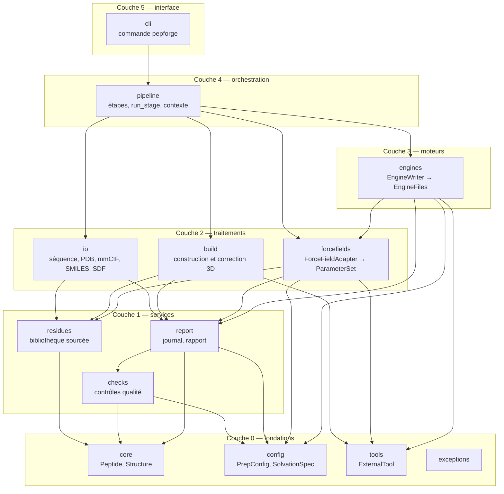
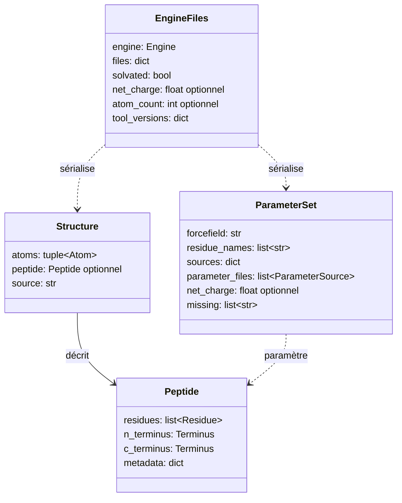
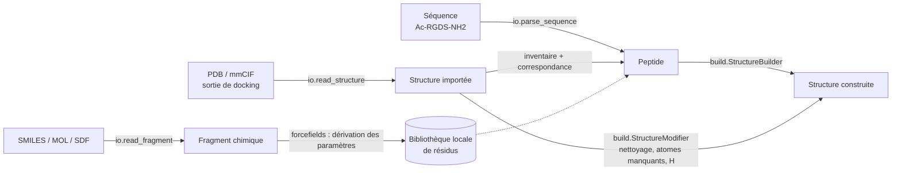
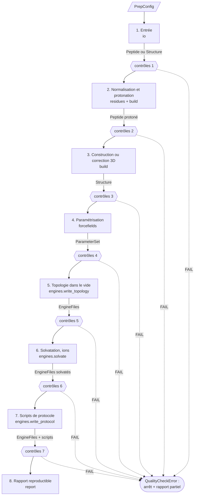
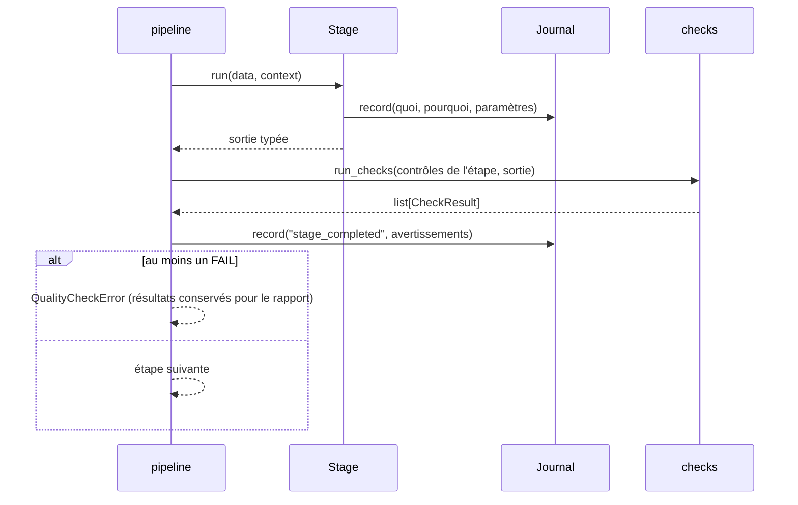
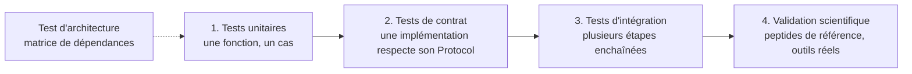
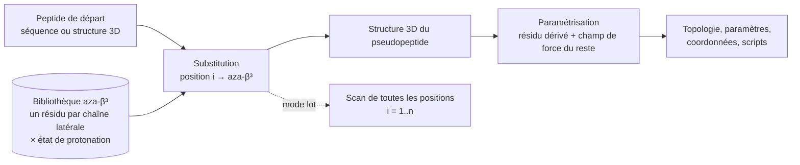

# PepForge — Architecture

> Document de référence de l'architecture. Il décrit les modules, ce que chacun a le droit de connaître, les types de données qu'ils échangent, l'enchaînement du pipeline, et la façon dont chaque étape est revue, contrôlée et testée.
>
> Le plan de construction étape par étape est dans [PLAN-CONSTRUCTION.md](PLAN-CONSTRUCTION.md). Les règles de développement sont dans [`CLAUDE.md`](../CLAUDE.md).

## Sommaire

1. [Principes](#1-principes)
2. [Vue d'ensemble des modules](#2-vue-densemble-des-modules)
3. [Règles de dépendance](#3-règles-de-dépendance)
4. [Types de données échangés](#4-types-de-données-échangés)
5. [Contrat de chaque module](#5-contrat-de-chaque-module)
6. [Flux du pipeline](#6-flux-du-pipeline)
7. [Vérification : revue, contrôles et tests](#7-vérification--revue-contrôles-et-tests)
8. [Modifier un module isolément](#8-modifier-un-module-isolément)
9. [Décisions ouvertes et compromis](#9-décisions-ouvertes-et-compromis)
10. [Cas d'usage central : substitution aza-β³](#10-cas-dusage-central--substituer-un-acide-aminé-par-un-résidu-aza-β³)
11. [Contraintes venues du projet de thèse](#11-contraintes-venues-du-projet-de-thèse)
12. [Portée confirmée le 26 novembre 2026](#12-portée-confirmée-le-26-novembre-2026)
13. [Intégrer un résidu aza-β³ dans CHARMM36m](#13-intégrer-un-résidu-aza-β³-dans-charmm36m)
14. [Métaux : données livrées et ajout manuel](#14-métaux--données-livrées-et-ajout-manuel)
15. [Calcul quantique : recommandation et interface](#15-calcul-quantique--recommandation-et-interface)
16. [Faisabilité des calculs sur un poste de bureau](#16-faisabilité-des-calculs-sur-un-poste-de-bureau)
17. [Politique d'absence d'erreur silencieuse](#17-politique-dabsence-derreur-silencieuse)
18. [Comment vérifier et valider une sortie](#18-comment-vérifier-et-valider-une-sortie)

---

## 1. Principes

| # | Principe | Conséquence concrète |
|---|---|---|
| P1 | **Un module, une responsabilité** | Chaque dossier de `src/pepforge/` a un rôle unique (section 5). |
| P2 | **Les modules ne se parlent que par des types déclarés** | Les échanges passent par les types de la section 4 (`Peptide`, `Structure`, `ParameterSet`, `EngineFiles`...). Aucun dictionnaire « fourre-tout ». |
| P3 | **Les dépendances vont dans un seul sens** | Une matrice autorise ou interdit chaque import (section 3). Elle est vérifiée par `tests/test_architecture.py` : un import interdit fait échouer la CI. |
| P4 | **Les interfaces sont des `Protocol`** | Un adaptateur, un moteur, un constructeur ou une étape se remplace sans toucher au reste, tant qu'il respecte son `Protocol` et passe ses tests de contrat (`tests/contracts.py`). |
| P5 | **Chaque étape est contrôlée à sa sortie** | `pipeline.run_stage` exécute l'étape, puis ses contrôles (`checks`) ; un contrôle en échec arrête tout (`QualityCheckError`). |
| P6 | **Rien n'est supposé** | Moteur, champ de force, modèle d'eau, objectif, pH, solvatation : aucune valeur par défaut (`PrepConfig`, `SolvationSpec`). Aucun paramètre numérique codé en dur : les données viennent de fichiers sourcés. |
| P7 | **Tout est tracé** | Chaque modification de structure est journalisée (`Journal`), chaque outil externe enregistre sa version, chaque contrôle laisse un résultat dans le rapport. |
| P8 | **Indépendance vis-à-vis du champ de force et du moteur** | `core`, `io`, `residues`, `build` et `checks` ne connaissent aucune nomenclature de champ de force (`NHE`, `HIE`...) ni aucun format moteur (`.prmtop`, `.top`, `.psf`). |

---

## 2. Vue d'ensemble des modules

Les flèches indiquent « importe ». Toutes les couches peuvent importer `exceptions` (non dessiné pour la lisibilité). Une flèche ne remonte jamais vers une couche supérieure.

| Module | Rôle | État |
|---|---|---|
| `exceptions` | Hiérarchie d'exceptions dédiées (`PepForgeError` et dérivées) | en place |
| `core` | Représentation interne : `Peptide`, `Residue`, `Terminus`, `Structure`, `Atom` | `Peptide` en place, `Structure` minimale |
| `config` | `PrepConfig`, `SolvationSpec`, `Engine`, `SimulationGoal` ; YAML aller-retour | en place |
| `tools` | `ExternalTool` : exécutable externe, version, détection d'échec dans la sortie | en place |
| `residues` | Bibliothèque de résidus et d'extrémités chargée depuis `residues/data/*.yaml`, avec provenance | acides aminés standards et extrémités usuelles |
| `checks` | Contrôles qualité : fonctions pures `sortie d'étape → CheckResult` | socle + 2 contrôles sur `Peptide` |
| `report` | `Journal` des opérations ; rapport de préparation reproductible | journal en place, rapport à écrire |
| `io` | Lecture et écriture : séquences, puis PDB, mmCIF, SMILES, MOL/SDF | séquences en place |
| `build` | Construction 3D depuis un `Peptide`, corrections d'une `Structure` | interfaces seulement |
| `forcefields` | Adaptateurs de champ de force → `ParameterSet` | interface seulement |
| `engines` | Écriture des fichiers d'un moteur, solvatation | interface seulement |
| `pipeline` | `Stage`, `StageContext`, `run_stage`, étapes concrètes | socle + étape « séquence » |
| `cli` | Commande `pepforge` | `parse`, `config-template` |

---

## 3. Règles de dépendance

Matrice des imports internes autorisés. La source de vérité exécutable est le dictionnaire `ALLOWED` de [`tests/test_architecture.py`](../tests/test_architecture.py) : les deux doivent rester identiques.

| Module ↓ peut importer → | exceptions | core | config | tools | residues | checks | report | io | build | forcefields | engines | pipeline |
|---|---|---|---|---|---|---|---|---|---|---|---|---|
| **exceptions** | — | | | | | | | | | | | |
| **core** | ✓ | — | | | | | | | | | | |
| **config** | ✓ | | — | | | | | | | | | |
| **tools** | ✓ | | | — | | | | | | | | |
| **residues** | ✓ | ✓ | | | — | | | | | | | |
| **checks** | ✓ | ✓ | ✓ | | | — | | | | | | |
| **report** | ✓ | ✓ | ✓ | | | ✓ | — | | | | | |
| **io** | ✓ | ✓ | | | ✓ | | ✓ | — | | | | |
| **build** | ✓ | ✓ | | ✓ | ✓ | | ✓ | | — | | | |
| **forcefields** | ✓ | ✓ | ✓ | ✓ | ✓ | | ✓ | | | — | | |
| **engines** | ✓ | ✓ | ✓ | ✓ | | | ✓ | | | ✓ | — | |
| **pipeline** | ✓ | ✓ | ✓ | ✓ | ✓ | ✓ | ✓ | ✓ | ✓ | ✓ | ✓ | — |
| **cli** | ✓ | ✓ | ✓ | | | ✓ | ✓ | ✓ | | | | ✓ |

Points essentiels :

- **`io`, `build` et `forcefields` ne se connaissent pas.** Ils sont reliés uniquement par `pipeline`, à travers les types de `core`. On peut donc remplacer le constructeur 3D sans toucher aux champs de force, et inversement.
- **`forcefields` n'importe jamais `engines`.** Un adaptateur produit des paramètres, il n'écrit pas de fichier moteur (règle 2 de `CLAUDE.md`). `engines` importe `forcefields` uniquement pour le type `ParameterSet`.
- **`tools` est une feuille.** `ExternalTool` est utilisé par `build`, `forcefields` et `engines` ; s'il était resté dans `pipeline`, ces modules auraient dû importer leur propre orchestrateur, ce qui crée une dépendance circulaire. C'est pourquoi il a été déplacé de `pepforge.pipeline.external` vers `pepforge.tools.external`.
- **`cli` ne contient aucune logique scientifique.** Il lit les arguments, appelle `pipeline` (ou `io` pour les commandes d'inspection) et affiche.
- Les imports relatifs (`from .x import y`) sont interdits, pour que la matrice reste vérifiable.

Le test vérifie aussi que la matrice ne contient pas de cycle, et que tout nouveau module y est déclaré.

---

## 4. Types de données échangés

Ce sont les seuls objets qui traversent les frontières entre modules. Chaque type appartient à un module unique, qui seul le modifie.

| Type | Module propriétaire | Produit par | Consommé par | Invariants |
|---|---|---|---|---|
| `PrepConfig` | `config` | utilisateur (YAML), `cli` | `pipeline`, `checks`, `report` | Aucun champ décisionnel n'a de valeur par défaut. `missing_decisions()` liste ce qui manque. Aller-retour YAML sans perte. |
| `SolvationSpec` | `config` | `PrepConfig.solvation` | `engines` | Aucune valeur par défaut ; vérifié par l'étape de solvatation. |
| `Peptide` | `core` | `io` (séquence, structure), `build` (mutation) | `build`, `forcefields`, `checks` | Extrémités N et C toujours explicites ; une extrémité par défaut est signalée dans `metadata`. Aucun nom propre à un champ de force. |
| `Residue`, `Terminus` | `core` | `residues` | tous | Immuables ; identifiants internes stables (`amide`, `acetyl`...). |
| `Structure`, `Atom` | `core` | `io` (PDB, mmCIF), `build` | `build`, `engines`, `checks` | Immuables ; coordonnées en Å ; nomenclature PDB, jamais celle d'un champ de force. |
| `ResidueLibrary` | `residues` | `residues.load_default_library()` | `io`, `build`, `forcefields` | Chaque fichier chargé déclare sa source (`sources`). |
| `ParameterSet`, `ParameterSource` | `forcefields` | un `ForceFieldAdapter` | `engines`, `checks`, `report` | `missing` vide avant toute écriture moteur ; `sources` non vide. |
| `EngineFiles` | `engines` | un `EngineWriter` | `pipeline`, `checks`, `report` | Charge nette et nombre d'atomes **relus** dans les fichiers produits, pas recopiés de l'entrée ; versions des outils présentes. |
| `ToolResult` | `tools` | `ExternalTool.run()` | `build`, `forcefields`, `engines` | Version de l'outil renseignée ; une sortie contenant un motif d'échec lève `ExternalToolError`. |
| `JournalEntry`, `Journal` | `report` | tout composant qui modifie une structure, `run_stage` | `report` | Ajout seulement, jamais de suppression. |
| `CheckResult` | `checks` | `Check` | `pipeline`, `report` | `FAIL` arrête le pipeline ; `WARN` est reporté dans le rapport. |
| `StageContext` | `pipeline` | `pipeline` | les étapes | Contient `config`, `journal`, `workdir`, résultats des contrôles. |

---

## 5. Contrat de chaque module

Pour chaque module : ce qu'il reçoit, ce qu'il rend, les erreurs qu'il lève, et ce qu'il ne doit jamais faire.

### 5.1 `core` — représentation interne

- **Entrées / sorties** : aucune entrée externe ; fournit `Peptide`, `Residue`, `Terminus`, `Structure`, `Atom`.
- **Ne fait jamais** : lire un fichier, connaître un champ de force ou un moteur, contenir une constante physique.
- **Évolutions prévues** : états de protonation par résidu, modifications de chaînes latérales, liaisons non linéaires (ponts disulfure, cyclisation), plusieurs chaînes (complexe).

### 5.2 `config` — configuration d'une préparation

- **Entrées** : dictionnaire ou fichier YAML. **Sorties** : `PrepConfig`.
- **Erreurs** : `ConfigurationError` (clé inconnue, valeur invalide, décision manquante via `require_complete()`).
- **Garantie** : le YAML écrit par le rapport suffit à relancer la préparation (règle 8).

### 5.3 `tools` — exécutables externes

- **Entrées** : nom de l'exécutable, arguments, motifs d'échec. **Sorties** : `ToolResult`.
- **Erreurs** : `ExternalToolError` (exécutable absent, code de retour non nul, motif d'échec dans la sortie).
- **Garantie** : la version est toujours enregistrée ; le code de retour seul ne suffit pas (tleap retourne 0 même en cas de paramètre manquant).

### 5.4 `residues` — bibliothèque sourcée

- **Entrées** : fichiers `residues/data/*.yaml`, chacun avec un champ `source`. **Sorties** : `ResidueLibrary`.
- **Erreurs** : `UnknownResidueError`, `UnknownTerminusError`.
- **Ne fait jamais** : contenir des paramètres de champ de force (ceux-ci vivent dans `forcefields/data/`). Contiendra des données chimiques sourcées : états de protonation, pKa de référence avec leur publication.

### 5.5 `checks` — contrôles qualité

- **Entrées** : la sortie d'une étape (`Peptide`, `Structure`, `ParameterSet`, `EngineFiles`). **Sorties** : `CheckResult` (`PASS`, `WARN`, `FAIL`).
- **Règles** : un contrôle est une fonction pure, sans effet de bord ni appel externe ; il référence l'item de [04-checklist-qualite.md](04-checklist-qualite.md) qu'il couvre (`checklist_item`).
- **Ne fait jamais** : décider d'arrêter le pipeline (c'est `pipeline.run_stage` qui le fait) ni corriger ce qu'il constate.

### 5.6 `report` — journal et rapport

- **Entrées** : opérations (`Journal.record`), résultats de contrôles, `PrepConfig`, versions d'outils. **Sorties** : journal YAML, rapport de préparation, configuration rejouable.
- **Garantie** : un rapport contient tout ce qu'il faut pour refaire la préparation à l'identique.

### 5.7 `io` — lecture et écriture

- **Entrées** : texte (séquence), fichiers PDB, mmCIF, SMILES, MOL/SDF. **Sorties** : `Peptide`, `Structure` (et, pour le mode « structure personnalisée », un fragment chimique à définir à l'étape 11 du plan).
- **Erreurs** : `SequenceParseError`, `UnknownResidueError`, `UnknownTerminusError`, `StructureError`.
- **Ne fait jamais** : corriger silencieusement une structure lue. Toute correction est un `StructureModifier` de `build`, journalisé.

### 5.8 `build` — construction et correction 3D

- **Interfaces** : `StructureBuilder.build(peptide, journal) -> Structure` ; `StructureModifier.apply(structure, journal) -> Structure`.
- **Erreurs** : `StructureError`, `ChemistryError`.
- **Garanties** : structure d'entrée jamais modifiée sur place ; extrémités conservées ; chaque transformation journalisée.
- **Ne fait jamais** : utiliser une nomenclature de champ de force.

### 5.9 `forcefields` — adaptateurs de champ de force

- **Interface** : `ForceFieldAdapter` avec `name`, `supported_engines`, `compatible_water_models`, `parametrize(peptide) -> ParameterSet`.
- **Erreurs** : `MissingParameterError` dès qu'un paramètre manque ; `ConfigurationError` pour un modèle d'eau incompatible.
- **Données** : `forcefields/data/` (correspondances de noms de résidus, fichiers à charger), chacune avec sa source.
- **Ne fait jamais** : écrire un fichier moteur, inventer un paramètre, substituer `NME` à `NHE`.

### 5.10 `engines` — fichiers d'entrée par moteur

- **Interface** : `EngineWriter` avec `engine`, `write_topology(structure, parameters, outdir) -> EngineFiles`, `solvate(files, spec, outdir, journal) -> EngineFiles`. Une méthode `write_protocol` (minimisation, équilibration, production) sera ajoutée à l'étape 9 du plan.
- **Erreurs** : `MissingParameterError` si `parameters.missing` n'est pas vide ; `ConfigurationError` si le couple champ de force / moteur n'est pas pris en charge ; `ExternalToolError`.
- **Garantie** : charge nette et nombre d'atomes relus dans les fichiers produits.
- **Ne fait jamais** : convertir implicitement depuis un autre moteur.

### 5.11 `pipeline` — orchestration

- **Interfaces** : `Stage[In, Out]` (`name`, `run(data, context) -> Out`), `StageContext`, `run_stage(stage, data, context, checks)`.
- **Rôle** : choisir les composants d'après `PrepConfig`, les enchaîner, appliquer les contrôles après chaque étape.
- **Ne fait jamais** : contenir de la chimie. Toute logique scientifique vit dans les modules des couches inférieures.

### 5.12 `cli` — interface en ligne de commande

- **Rôle** : traduire des arguments en appels à `pipeline` ou `io`, afficher les résultats, convertir `PepForgeError` en message lisible et code de sortie 1.

---

## 6. Flux du pipeline

### 6.1 Les trois modes d'entrée convergent

Les trois modes aboutissent au même couple `Peptide` + `Structure`. Un fragment personnalisé n'entre pas directement dans la chaîne : il devient d'abord un résidu de la bibliothèque locale, avec ses paramètres et leur provenance, puis il est utilisé comme n'importe quel résidu.

### 6.2 Chaîne de préparation

> **Écart avec l'ordre de la spécification (section 4 de [01-specification-fonctionnelle.md](01-specification-fonctionnelle.md))** : la construction 3D (étape 3 ici) précède la paramétrisation (étape 4). La structure est construite dans une nomenclature neutre, puis le champ de force est appliqué ; on peut ainsi changer de champ de force sans reconstruire. Le « choix du couple champ de force / moteur » de la spécification n'est pas une étape : il est fixé dans `PrepConfig` et vérifié avant le lancement (`require_complete()`).

> **Conversion entre moteurs** (ex. AMBER → GROMACS) : étape optionnelle 5 bis, distincte, avec ses propres contrôles (nombre d'atomes, charge nette, énergie en point unique comparés avant et après). Jamais implicite.

### 6.3 Exécution d'une étape

### 6.4 Tableau des étapes

| # | Étape | Module | Entrée → sortie | Contrôles à la sortie (items de la checklist 04) |
|---|---|---|---|---|
| 1 | Entrée | `io` | texte ou fichier → `Peptide` / `Structure` | résidus reconnus, extrémités déclarées (sinon `WARN`), inventaire de la structure importée |
| 2 | Normalisation, protonation | `residues`, `build` | `Peptide` + pH → `Peptide` protoné | état de chaque groupe ionisable choisi et sourcé ; charge nette théorique calculée |
| 3 | Construction / correction 3D | `build` | `Peptide` ou `Structure` → `Structure` | nombre de résidus, extrémités conservées, aucun atome manquant, hydrogènes présents, stéréochimie, conformations alternatives résolues |
| 4 | Paramétrisation | `forcefields` | `Peptide` → `ParameterSet` | `missing` vide, provenance renseignée, modèle d'eau compatible, fragments obtenus par analogie signalés |
| 5 | Topologie | `engines` | `Structure` + `ParameterSet` → `EngineFiles` | charge nette relue = charge théorique, nombre d'atomes, résidus terminaux (`NHE` et non `NME` pour `-CO-NH2` en AMBER), aucun avertissement de l'outil |
| 6 | Solvatation | `engines` | `EngineFiles` + `SolvationSpec` → `EngineFiles` | système neutre, concentration en sel, marge de boîte, aucun chevauchement |
| 7 | Protocole | `engines` | `EngineFiles` + protocole → scripts | équilibration NVT puis NPT, pas d'intégration cohérent avec les contraintes, électrostatique longue portée déclarée, répliques |
| 8 | Rapport | `report` | tout ce qui précède → rapport + YAML rejouable | versions d'outils, journal complet, objectif de simulation consigné |

---

## 7. Vérification : revue, contrôles et tests

Chaque étape est vérifiée à quatre niveaux. Les trois premiers sont automatiques et tournent dans la CI à chaque PR ; le quatrième combine automatisation et relecture scientifique.

### 7.1 Niveaux de tests

| Niveau | Ce qui est vérifié | Où | Quand il tourne |
|---|---|---|---|
| **Architecture** | Imports conformes à la matrice, pas de cycle, tout module déclaré | `tests/test_architecture.py` | à chaque PR (CI) |
| **Unitaire** | Une fonction : cas nominal, cas limites, erreurs attendues | `tests/test_<module>.py` | à chaque PR (CI) |
| **Contrat** | Une implémentation respecte son `Protocol` et les garanties de la section 5 | `tests/contracts.py` (fonctions réutilisables), appelées par les tests de chaque implémentation | à chaque PR (CI) |
| **Intégration** | Enchaînement d'étapes via `run_stage`, avec composants factices ou réels | `tests/integration/` | à chaque PR ; les tests nécessitant AmberTools, GROMACS ou NAMD sont marqués `@pytest.mark.external` et sautés si l'outil est absent |
| **Validation scientifique** | Résultats comparés à des valeurs de référence établies indépendamment (à la main ou par un outil publié) | `tests/reference/` + relecture | avant chaque version, et à chaque ajout de résidu, de champ de force ou de moteur |

Fonctions de contrat disponibles dans [`tests/contracts.py`](../tests/contracts.py) :

- `assert_forcefield_contract(adapter, peptides)` : `ParameterSet` complet, `missing` vide, provenance présente ;
- `assert_engine_writer_contract(writer, structure, tmp_path)` : refus d'un `ParameterSet` incomplet ;
- `assert_builder_contract(builder, peptide)` : structure produite, extrémités conservées, construction journalisée ;
- `assert_stage_contract(stage, data, tmp_path)` : l'étape a un nom et s'exécute avec un contexte.

### 7.2 Peptides de référence

Jeu commun à toutes les étapes de validation, enrichi au fil du plan. Les valeurs attendues sont établies indépendamment de PepForge et documentées avec leur source dans `tests/reference/` avant d'être utilisées.

| Peptide | Ce qu'il exerce |
|---|---|
| `Ac-RGDS-NH2` | extrémités acétylée et amidée (`NHE` en AMBER), charges opposées Arg / Asp |
| `H-RGDS-OH` | extrémités libres, charges terminales |
| `Ac-RGDS-NHMe` | N-méthylamide : vérifie que `NME` n'est pas confondu avec `NHE` |
| Peptide avec His | choix du tautomère et de l'état de protonation selon le pH |
| Peptide avec Cys–Cys | pont disulfure (quand `core` le prendra en charge) |
| `Ac-RGDS-NH2` avec une position substituée en aza-β³ | **cas d'usage central** : greffage, paramètres dérivés, torsion N–N (section 10) |
| Le même peptide substitué en chaque position | mode lot, comparaison entre positions |
| Peptide portant deux résidus aza-β³ **adjacents** | charges de jonction entre deux résidus dérivés (section 12.1) |
| Dipeptide, et peptide d'une centaine de résidus | les deux extrémités de la gamme 2 à 100 résidus (section 12.5) |
| Peptide portant un chélateur, avec et sans métal | volet radiomarquage (sections 11.2 et 11.4) |
| Peptides de la thèse (ciblant DCC, TrkC, UNC5) | à fournir par Firas |

### 7.3 Contrôles d'exécution

Les contrôles de `checks` ne sont pas des tests : ils tournent à chaque préparation réelle, sur les données de l'utilisateur. Un contrôle couvre un item de [04-checklist-qualite.md](04-checklist-qualite.md) et l'indique dans `checklist_item`. Objectif : que chaque item automatisable de la checklist ait son contrôle. Les items non automatisables (relecture de la convergence de l'équilibration, par exemple) apparaissent dans le rapport comme « à vérifier manuellement ».

### 7.4 Revue de chaque PR

Le modèle [`.github/pull_request_template.md`](../.github/pull_request_template.md) impose, pour chaque PR :

1. l'étape du plan concernée et ses critères d'acceptation, cochés un à un ;
2. les modules touchés et la confirmation que la matrice de dépendances n'a pas changé (ou la justification de son changement, reportée dans ce document) ;
3. les tests ajoutés à chaque niveau ;
4. la provenance de toute nouvelle donnée scientifique ;
5. la CI verte : `ruff`, `mypy --strict`, `pytest` sur Python 3.11, 3.12 et 3.13.

---

## 8. Modifier un module isolément

| Je veux... | Je touche | Je ne touche pas | Je vérifie |
|---|---|---|---|
| Ajouter un acide aminé non standard | `residues/data/` (+ `forcefields/data/` pour ses paramètres) | le code de `io`, `build`, `engines` | test de charge nette et de paramètres manquants (règle 7) |
| Ajouter un champ de force | un nouvel adaptateur dans `forcefields/` | `engines` (s'il cible un moteur existant) | `assert_forcefield_contract` + validation sur les peptides de référence |
| Ajouter un moteur | un nouveau `EngineWriter` dans `engines/` | `forcefields`, `build` | `assert_engine_writer_contract` + comparaison avec un moteur existant |
| Changer d'outil de construction 3D | un nouveau `StructureBuilder` dans `build/` | `forcefields`, `engines` | `assert_builder_contract` + contrôles de l'étape 3 |
| Lire un nouveau format | `io/` | tout le reste | tests unitaires de lecture, aller-retour lecture / écriture |
| Ajouter un contrôle qualité | `checks/` et la déclaration de l'étape dans `pipeline` | les composants contrôlés | test du contrôle sur un cas `PASS` et un cas `FAIL` |
| Ajouter une commande | `cli/` | toute la logique | test de la commande (`tests/test_cli.py`) |

Si une modification oblige à toucher deux modules qui ne devraient pas se connaître, c'est le signe qu'il manque un type d'échange dans `core` ou un paramètre dans `PrepConfig` : ajouter ce type plutôt qu'un import de contournement.

---

## 9. Décisions ouvertes et compromis

### 9.1 Décisions scientifiques en attente (Firas)

> Mise à jour du 26 novembre 2026 : le descriptif de thèse (section 11) tranche le moteur, le système simulé et la variante pseudopeptidique. Les lignes barrées ci-dessous sont résolues.

| Décision | Bloque | Où elle s'enregistre |
|---|---|---|
| ~~Moteur principal~~ → **NAMD**, d'après le projet de thèse | étapes 7 et suivantes du plan | `PrepConfig.engine = namd` |
| ~~Champ de force principal~~ → **CHARMM36m + CGenFF**, confirmé par Firas le 26 novembre 2026 | étape 6 du plan | `PrepConfig.forcefield` |
| ~~Système simulé~~ → **les deux**, le complexe peptide–récepteur étant le cas principal | étapes 10 et 12 du plan | `PrepConfig.goal` |
| ~~Périmètre du radiomarquage~~ → **les deux** : peptide + chélateur sans métal, **et** peptide marqué (section 11.2) | volet chélateurs | `PrepConfig` (champ à ajouter) |
| Approche de paramétrisation du centre métallique (non lié, lié, atomes factices) et format retenu pour le système marqué (section 11.4) | étape 11F du plan | procédure de dérivation + `PrepConfig.forcefield` |
| Outil de construction 3D | étape 5 du plan | composant de `build` |
| Bibliothèque chimique pour SMILES / SDF (RDKit ou autre) | étape 11A du plan | dépendance optionnelle de `pyproject.toml` |
| Variante aza exacte : aza-β³ `-NH-N(R)-CH2-CO-` ou azapeptide α `-NH-N(R)-CO-` | tout le fil aza (section 10) | `ResidueTemplate` de la bibliothèque |
| Méthode de charges et niveau de théorie quantique | étape 11C du plan | procédure de dérivation, consignée dans le rapport |
| Logiciel de calcul quantique disponible — **non mentionné dans le projet de thèse, reste le principal inconnu** | étapes 11C et 11D du plan | `ExternalTool` dédié |
| ~~Séquences candidates~~ → **tout peptide de 2 à 100 résidus**, pas de liste figée | peptides de référence des tests | — |
| Moteurs : **NAMD d'abord, GROMACS ensuite** (même champ de force), **AMBER en dernier** (coût élevé, section 12.4) | étape 13 du plan | `PrepConfig.engine` |

### 9.2 Compromis d'architecture assumés

- **Construction 3D et paramétrisation séparées.** Des outils comme `tleap` font les deux à la fois. Ici, `build` produit une structure neutre et `engines` peut rappeler `tleap` pour écrire la topologie. Coût : une étape de plus. Bénéfice : changer de champ de force sans reconstruire, et tester chaque étape séparément.
- **`ParameterSet` décrit, il ne contient pas toutes les constantes.** Pour un champ de force publié, il référence les fichiers officiels à charger (`parameter_files`) plutôt que de recopier chaque constante dans des objets Python. Les constantes restent dans leurs fichiers d'origine, ce qui respecte la règle « pas d'invention de paramètres ».
- **`Protocol` plutôt que classes abstraites.** Une implémentation n'hérite de rien : elle est remplaçable par n'importe quel objet de même forme. Les tests de contrat compensent l'absence de vérification à l'héritage.
- **Contrôles séparés des composants.** Un même contrôle (charge nette, extrémités) s'applique à tous les moteurs et champs de force, au lieu d'être réécrit dans chaque implémentation.
- **`solvation` hors de `missing_decisions()`.** Les paramètres de solvatation ne sont exigés qu'au lancement de l'étape de solvatation, pour pouvoir utiliser PepForge sur les premières étapes sans les avoir fixés.

---

## 10. Cas d'usage central : substituer un acide aminé par un résidu aza-β³

Cette section a été ajoutée après la précision de Firas (26 novembre 2026) : la fonction centrale de PepForge est de **remplacer un acide aminé d'un peptide par le résidu pseudopeptidique aza-β³ correspondant, pour n'importe quel acide aminé et n'importe quelle position, puis de produire les fichiers de dynamique moléculaire**. Ce n'est donc pas un cas particulier du mode « structure chimique personnalisée » : c'est le chemin principal, et le reste de l'outil doit le servir.

### 10.1 Chaîne attendue

### 10.2 Ce que la substitution change, du point de vue du modèle

> **À confirmer par Firas** : la variante visée est bien l'aza-β³, c'est-à-dire un squelette `-NH-N(R)-CH2-CO-`. L'azapeptide « α » classique (`-NH-N(R)-CO-`, semicarbazide, sans le CH2) est une autre famille. Les conséquences ci-dessous sont écrites pour l'aza-β³ ; elles changent si c'est l'autre variante.

| | Résidu α standard | Résidu aza-β³ |
|---|---|---|
| Squelette | `-NH-CαH(R)-CO-` | `-NH-N(R)-CH2-CO-` |
| Atomes de squelette | 3 (N, Cα, C) | 4 (N, N, CH2, C) |
| Liaison nouvelle | — | **N–N** (hydrazide) |
| Centre stéréogène | Cα (L ou D) | **disparaît** : l'azote substitué n'est pas un centre stéréogène stable |
| Chaîne latérale | portée par Cα | portée par l'azote |
| Torsions du squelette | φ, ψ, ω | φ, ψ, ω **plus** la torsion autour de N–N |

Trois conséquences pour l'architecture :

1. La substitution **allonge le squelette d'un atome**. Le modèle de données ne peut donc pas supposer qu'un résidu vaut trois atomes de squelette ; un contrôle doit vérifier la connectivité après greffage plutôt que de compter des atomes supposés.
2. Elle **supprime un centre stéréogène** : les contrôles de stéréochimie doivent attendre un Cα chiral sur les résidus α et aucun sur les résidus aza.
3. Elle **introduit une liaison N–N dans le squelette**, ce qui est le point dur ci-dessous.

### 10.3 Le point dur : aucun champ de force protéique ne couvre le squelette N–N

Les champs de force protéiques (ff14SB, ff19SB, CHARMM36m) décrivent le squelette des acides aminés α ; leurs torsions de squelette sont ajustées sur ce squelette. Un résidu aza-β³ n'y figure pas. Les champs de force généralistes (GAFF2, CGenFF) couvrent les molécules organiques, hydrazides compris, mais par analogie : leurs torsions autour d'une liaison N–N ne sont pas ajustées pour reproduire les préférences conformationnelles d'un pseudopeptide.

En conséquence, pour **chaque** résidu aza-β³ de la bibliothèque :

- les paramètres doivent être **dérivés** (voie GAFF2 via `antechamber` / `parmchk2` pour AMBER, CGenFF pour CHARMM) et non repris d'un champ de force publié ;
- les charges doivent être calculées sur un **fragment coiffé** (type `Ace-X-Nme`), puis ajustées pour que la charge nette du résidu soit entière et que les atomes de jonction restent compatibles avec les résidus voisins du champ de force protéique ;
- les **torsions du squelette, et en particulier celle autour de N–N, doivent être validées** contre des balayages dièdres relaxés en calcul quantique, avant toute simulation de production. Sans cette validation, les conformations obtenues ne sont pas interprétables.
- la **recherche bibliographique** (existe-t-il des paramètres publiés pour des aza-peptides ou des β-peptides réutilisables, et à quel niveau de théorie ?) est une tâche à part entière, préalable à l'étape de dérivation. Aucun jeu de paramètres n'est écrit dans le dépôt sans sa source ou sa procédure de dérivation complète.

### 10.4 Ce que l'architecture actuelle couvre déjà

| Besoin du cas d'usage | Déjà prévu |
|---|---|
| Représenter un peptide dont un résidu n'est pas standard | `core.Residue` a un indicateur `standard`, et `Peptide` n'impose aucune nomenclature |
| Remplacer un résidu dans une structure 3D | `build.StructureModifier` (mutation), avec structure immuable et journal obligatoire |
| Bibliothèque de résidus non standards versionnée, avec provenance | `residues/` et `residues/data/`, où chaque fichier déclare sa source |
| Refuser de simuler avec un paramètre manquant | `MissingParameterError`, `ParameterSet.missing` vide exigé, contrôle avant écriture moteur |
| Signaler un paramètre obtenu par analogie | `ParameterSource` et le niveau de confiance prévu à l'étape 11 du plan |
| Charge nette vérifiée | charge théorique (étape 2 du plan) comparée à la charge relue dans les fichiers produits (étape 7) |
| Entrée par SMILES / MOL / SDF pour un fragment | mode d'entrée 2.3 de la spécification, module `io` |

L'ossature est donc la bonne : **rien à reconstruire**. Ce qui manque est ci-dessous.

### 10.5 Ce qu'il faut ajouter

| # | À ajouter | Module | Pourquoi |
|---|---|---|---|
| A1 | Type `ResidueTemplate` : fragment chimique, atomes d'ancrage côté N et côté C, atomes à retirer lors du greffage, charge du fragment | `core` | C'est l'objet qu'échangent la bibliothèque, le greffage et la paramétrisation. Sans lui, `build` et `forcefields` devraient se connaître. |
| A2 | Bibliothèque aza-β³ : une entrée par chaîne latérale **et par état de protonation**, versionnée, avec la procédure de dérivation de chaque entrée | `residues/data/` | « Fonctionner sur tous les acides aminés » veut dire une vingtaine de chaînes latérales, dont sept ionisables, donc une trentaine d'entrées à dériver et valider. |
| A3 | Sous-pipeline de dérivation : fragment coiffé → calcul quantique → charges → `parmchk2` / CGenFF → fichier de paramètres + niveau de confiance | `forcefields` (nouveau sous-module `derivation`) | C'est l'étape la plus coûteuse et la plus sensible. Elle doit être reproductible, journalisée et rejouable à l'identique. |
| A4 | `MutateResidue` : greffage du template à la position i, reconstruction des liaisons de jonction, minimisation locale du voisinage, conservation du reste de la structure | `build` | Le cœur de la fonction demandée. |
| A5 | Mode « scan de positions » : même peptide, substitution en i pour i = 1..n, un système préparé par position | `pipeline` | C'est l'usage réel : comparer les positions entre elles, pas préparer un seul système. |
| A6 | Contrôles propres à la substitution : connectivité du squelette après greffage, longueur et angles de la liaison N–N dans une plage sourcée, absence de centre stéréogène attendu sur le résidu aza, charge nette entière du résidu, aucune torsion manquante autour de N–N, chaîne latérale intacte | `checks` | Les contrôles existants supposent un squelette α. |
| A7 | Validation des torsions contre des balayages dièdres quantiques, avec les courbes conservées dans `tests/reference/` | tests + `docs` | Sans elle, les paramètres dérivés ne sont pas défendables dans une thèse. |
| A8 | Journal et rapport étendus : pour chaque résidu dérivé, méthode de charges, niveau de théorie, pénalités d'analogie, version des outils | `report` | Traçabilité exigée par la règle 3 du projet. |

Ces ajouts ne changent **aucune** règle de dépendance de la section 3 : `ResidueTemplate` vit dans `core`, la dérivation dans `forcefields`, le greffage dans `build`, le lot dans `pipeline`. C'est la vérification que l'architecture tient pour ce cas d'usage.

### 10.6 Décisions à prendre avant de coder ce fil

| Décision | Pourquoi elle bloque |
|---|---|
| Variante exacte : aza-β³ (`-NH-N(R)-CH2-CO-`) ou azapeptide α (`-NH-N(R)-CO-`) | Change le template, les contrôles et les paramètres à dériver |
| Voie de paramétrisation : AMBER + GAFF2 ou CHARMM + CGenFF | Change tout le sous-module de dérivation |
| Méthode de charges et niveau de théorie (AM1-BCC, RESP sur HF/6-31G\*, autre) | Doit être fixée une fois pour toute la bibliothèque, sinon les résidus ne sont pas comparables entre eux |
| Logiciel de calcul quantique disponible | Conditionne la faisabilité de A3 et A7 |
| Substitution d'un seul résidu à la fois, ou plusieurs simultanément | Change `MutateResidue` et le mode lot |

---

## 11. Contraintes venues du projet de thèse

Section ajoutée le 26 novembre 2026 après lecture du descriptif de thèse de Firas (« Conception, synthèse, activité et validation in vitro de pseudopeptides théranostiques contenant des acides aminés aza-β³, spécifiques aux récepteurs à dépendance »). Les éléments ci-dessous viennent de ce document et remplacent plusieurs suppositions laissées ouvertes.

### 11.1 Ce que le document tranche

| Point | Ce que dit le projet de thèse | Conséquence pour PepForge |
|---|---|---|
| Variante pseudopeptidique | acides aminés **aza-β³** | confirmée par Firas ; la section 10 s'applique telle quelle |
| Champ de force | déduit du moteur NAMD | **CHARMM36m + CGenFF**, confirmé par Firas le 26 novembre 2026 ; fichiers détaillés en 11.3 |
| Moteur de dynamique moléculaire | **NAMD**, cité pour l'affinement des modèles, la dynamique moléculaire et la minimisation d'énergie, avec **VMD** | le premier `EngineWriter` est NAMD (`psfgen` : `.psf`, `.pdb`, plus `.prm`/`.rtf`/`.str`) |
| Visualisation | PyMOL, VMD | hors périmètre de PepForge, mais les fichiers produits doivent s'ouvrir dans ces outils |
| Système simulé | docking (AutoDock4, Vina, HADDOCK, PatchDock, FireDock) **puis** dynamique moléculaire pour évaluer affinité et spécificité | les **deux** scénarios sont nécessaires, et le **complexe peptide–récepteur** est le cas principal, pas une extension |
| Peptides de départ | régions de la **nétrine-1** et de la **NT-3**, séquences et structures tirées de la PDB et d'UniProt | les peptides de référence doivent venir de ces séquences ; à demander à Firas (deux projets de master déjà réalisés) |
| Récepteurs | DCC, TrkC, UNC5, récepteur de la nétrine-1 | structures à récupérer dans la PDB, à préparer avec les mêmes contrôles que le peptide |
| Structures expérimentales | RMN (CARA, ARIA), validation SAVES 6.0 | `io` doit lire un **ensemble RMN** (PDB multi-modèles) et pas seulement un modèle unique |

### 11.2 Ce que le document ajoute au périmètre : chélateurs et radiométaux

Les peptides de la thèse ne sont pas de simples peptides : ils portent un **chélateur** greffé à l'extrémité N-terminale ou C-terminale amide, et sont **radiomarqués**.

- Chélateurs prévus : DOTA (sous forme protégée DOTA(tBu)₃), N4 (6-carboxy-1,4,8,11-tétraazaundécane, (Boc)₄-N4), HYNIC (acide 6-hydrazinonicotinique, Boc-HYNIC).
- Radiométaux prévus : **gallium, rhénium, lutécium, technétium-99m**.
- Des groupes fonctionnels (DOTA, maléimide ou autres) peuvent être greffés sur la chaîne principale **ou sur une chaîne latérale**.

Conséquences, à trancher avec Firas avant d'écrire du code pour ce volet :

1. Un chélateur est, du point de vue de l'architecture, un **`ResidueTemplate` terminal ou latéral** : même mécanique de greffage et de dérivation que pour un résidu aza-β³ (section 10.5). L'architecture le couvre sans changement.
2. Le **complexe métallique est un problème distinct et plus difficile**. Les champs de force classiques ne décrivent pas les métaux de transition de façon transférable ; paramétrer un complexe Tc, Re, Lu ou Ga demande une approche dédiée (modèle de liaison, modèle de points cationiques factices, ou contraintes), chacune avec ses limites. Rien ne sera écrit sans source ni procédure.
3. **Périmètre tranché par Firas le 26 novembre 2026 : les deux cas.** PepForge doit préparer le peptide **portant son chélateur sans métal** et le peptide **marqué, métal compris**. Le premier cas est une extension directe de la section 10 ; le second est traité en 11.4, parce qu'il pose un problème de nature différente. C'est cohérent avec le projet de thèse, qui teste les peptides « marqués ou non ».

### 11.3 Les fichiers CHARMM et NAMD à produire

Le couple retenu est **CHARMM36m + CGenFF, moteur NAMD** (confirmé par Firas le 26 novembre 2026). Voici ce que PepForge doit produire, et qui le produit. La règle 2 du projet s'applique : l'adaptateur de champ de force décrit les paramètres, le module `engines` écrit les fichiers.

| Fichier | Ce qu'il contient | Produit par |
|---|---|---|
| `.rtf` (*residue topology file*) | pour chaque résidu : noms et types d'atomes, charges partielles, connectivité, et les *patches* (`PRES`) de liaison et d'extrémité | `forcefields` décrit, `engines` écrit |
| `.prm` ou `.par` (*parameter file*) | paramètres liés et non liés **par type d'atome** : liaisons, angles, dièdres, impropres, termes de Lennard-Jones | fourni par CHARMM36m pour les résidus standards ; complété pour les résidus dérivés |
| `.str` (*stream file*) | un fichier qui porte **à la fois** une section de topologie et une section de paramètres, pour une molécule ou un résidu donné. C'est la sortie de CGenFF pour un fragment personnalisé | `forcefields.derivation` |
| `.psf` (*protein structure file*) | la description du système assemblé : tous les atomes, leurs types, leurs charges, et les listes de liaisons, angles, dièdres et impropres | `engines` via `psfgen` |
| `.pdb` ou `.crd` | les coordonnées | `engines` |
| fichier de configuration NAMD | le script de la simulation : minimisation, équilibration, production, traitement de l'électrostatique, rayons de coupure | `engines.write_protocol` |

Deux pièges à éviter, inscrits comme contrôles :

1. **Un `.str` n'est pas un fichier de coordonnées.** La spécification fonctionnelle le signalait déjà ; le contrôle refuse un `.str` présenté comme tel.
2. **La sortie de CGenFF décrit une molécule isolée, pas un résidu de chaîne.** Pour intégrer un résidu aza-β³ dans un peptide, il faut en tirer une entrée `RESI` avec ses atomes de liaison, ou un `PRES`, puis **ajuster les charges pour que le résidu porte une charge entière et que ses atomes de jonction restent compatibles avec les résidus CHARMM36m voisins**. C'est le cœur de l'étape 11C, et c'est là que se joue la qualité du résultat. Les **pénalités CGenFF** (pénalité de charge et pénalité de paramètre) sont conservées et reportées dans le rapport : au-delà d'un seuil à fixer avec Firas, elles imposent une dérivation quantique.

### 11.4 Le centre métallique : un problème de nature différente

Le périmètre inclut le peptide marqué (gallium, rhénium, lutécium, technétium-99m). Il faut dire clairement pourquoi c'est plus difficile que le reste : les champs de force classiques décrivent mal les métaux de transition, parce que la coordination est directionnelle et partiellement covalente, alors que ces champs de force reposent sur des charges ponctuelles et des termes non liés isotropes.

Trois familles d'approches existent, et **le choix doit être documenté avec sa source** ; aucune n'est retenue par défaut :

| Approche | Principe | Limite principale |
|---|---|---|
| Modèle non lié | le métal est un ion ponctuel, charge et termes de Lennard-Jones | ne tient pas la géométrie de coordination : le métal peut quitter le chélateur |
| Modèle lié | liaisons explicites métal–ligand, paramètres ajustés sur un calcul quantique du complexe | demande un calcul quantique par complexe, et interdit tout échange de ligand |
| Atomes factices cationiques | des pseudo-atomes autour du métal imposent la géométrie | paramétrisation délicate, et dépend de la géométrie de coordination supposée |

Deux points d'honnêteté à porter dans la thèse :

- Le **technétium et le rhénium** sous forme de cœurs oxo (typiquement rencontrés avec HYNIC et des co-ligands) sont les cas les plus difficiles : la nature exacte du complexe formé lors du radiomarquage n'est pas toujours établie. Si elle ne l'est pas, le système simulé repose sur une hypothèse structurale qu'il faut énoncer comme telle. Le gallium et le lutécium, cations durs dans un DOTA, sont plus traitables.
- **Tension de format à surveiller.** L'outillage de construction des modèles liés métal–ligand est historiquement plus développé du côté AMBER que du côté CHARMM. Or NAMD lit aussi les topologies AMBER. Si un modèle lié s'avère nécessaire, il y a deux voies acceptables, et une interdite :
  - dériver ou trouver des paramètres **compatibles CHARMM**, et rester en `.psf` / `.prm` ;
  - préparer **tout le système marqué** au format AMBER, lu par NAMD, en traitant cela comme une préparation distincte et vérifiée ;
  - **interdit** : mélanger un champ de force protéique CHARMM et des paramètres métalliques AMBER dans un même système. C'est la règle 4 du projet, et un contrôle doit le refuser.

### 11.5 Cohérence avec le reste de l'architecture

Aucune règle de dépendance de la section 3 ne change :

- le chélateur et le résidu aza-β³ passent tous deux par `core.ResidueTemplate`, la bibliothèque de `residues/` et la dérivation de `forcefields` ;
- NAMD devient une implémentation de `EngineWriter` dans `engines`, sans effet sur `forcefields` ni sur `build` ;
- l'ensemble RMN multi-modèles est une capacité de lecture de `io`, avec un contrôle qui impose le choix explicite du modèle à préparer ;
- le complexe peptide–récepteur reste l'étape 12 du plan, mais devient prioritaire au même titre que le peptide libre.

---

## 12. Portée confirmée le 26 novembre 2026

Firas a précisé quatre points qui élargissent la portée. Chacun est traité ci-dessous avec son coût réel.

### 12.1 Substitutions multiples, en nombre et en types quelconques

Une préparation doit accepter **une, deux ou plus** substitutions aza-β³, sur un **même type** d'acide aminé ou sur **plusieurs types différents**, dans un peptide de **2 à 100 résidus**.

Conséquences :

- La substitution est une opération **répétable**, pas un cas unique : `MutateResidue` s'applique n fois, chaque application étant journalisée séparément.
- Le cas **deux résidus aza-β³ adjacents** est particulier : les deux atomes de jonction qui se font face appartiennent tous deux à un résidu dérivé, et non à un résidu CHARMM36m. Il demande son propre jeu de charges de jonction et son propre test.
- Le mode lot de l'étape 11E ne se limite pas à « une position à la fois » : il doit pouvoir énumérer des **combinaisons** de positions. Le nombre de combinaisons explose avec la taille du peptide, donc l'utilisateur déclare explicitement les combinaisons voulues ; PepForge ne les énumère jamais toutes de lui-même.

### 12.2 Deux voies de paramétrisation, et pourquoi la bibliothèque reste la voie principale

Firas souhaite faire tourner CGenFF sur **la molécule entière** modifiée. C'est faisable, mais ce n'est pas interchangeable avec la voie par bibliothèque de résidus. Voici la comparaison honnête.

| | Voie A — bibliothèque de résidus | Voie B — molécule entière dans CGenFF |
|---|---|---|
| Ce qui passe dans CGenFF | le fragment aza-β³ coiffé, une fois par chaîne latérale | le peptide modifié complet, à chaque nouveau peptide |
| Résidus standards | gardent **CHARMM36m**, avec ses torsions de squelette et sa correction **CMAP** ajustées pour les peptides | reçoivent des paramètres **génériques** CGenFF, sans CMAP |
| Réutilisation | une dérivation sert à tous les peptides et toutes les positions | aucune : chaque peptide, chaque position, chaque combinaison repart de zéro |
| Taille praticable | toute la gamme 2 à 100 résidus | petites molécules seulement ; la limite en nombre d'atomes de la version utilisée est à vérifier, et 100 résidus font plus d'un millier d'atomes |
| Jonctions | travail de charges de jonction à faire, une fois par chaîne latérale | pas de jonction à traiter : CGenFF voit la connectivité réelle |
| Pénalités | calculées sur le fragment, hors contexte de chaîne | calculées dans le contexte réel |

**Recommandation : la voie A est la voie principale, la voie B sert de contrôle croisé.** Deux raisons décisives :

1. La voie B **abandonne CHARMM36m pour les résidus standards**. Pour un peptide de 100 résidus, cela revient à décrire un petit peptide structuré avec un champ de force généraliste, sans la correction CMAP. C'est un recul, pas un progrès.
2. La voie B ne tient pas à l'échelle demandée : chaque combinaison de substitutions exigerait une paramétrisation complète.

En revanche, la voie B a une vraie valeur comme **vérification** : sur un peptide court (deux à cinq résidus) portant une substitution, on compare les charges et les paramètres obtenus par la bibliothèque à ceux obtenus sur la molécule entière. Un écart important révèle une erreur dans le traitement des jonctions. C'est un test de validation à part entière, inscrit à l'étape 11C.

**Limite à écrire dans la thèse** : un résidu aza-β³ ne bénéficie d'aucune correction CMAP, puisque celle-ci est ajustée pour le squelette des acides aminés α. C'est une raison de plus pour valider les torsions du squelette, y compris celle autour de N–N, contre des balayages quantiques (étape 11D).

### 12.3 « Un métal, quelle que soit sa nature »

Le **mécanisme** est générique, et c'est ce que l'architecture garantit : un centre métallique est décrit par un enregistrement de données (élément, état d'oxydation, charge, géométrie de coordination attendue, atomes donneurs du chélateur, approche de paramétrisation retenue), au même titre qu'un `ResidueTemplate`. Ajouter un métal, c'est ajouter une entrée de données, pas du code.

En revanche, et il faut être clair : **les paramètres, eux, ne sont pas génériques**. Pour chaque métal et chaque chélateur, il faut soit des paramètres publiés et cités, soit une dérivation documentée. Un métal sans entrée validée lève `MissingParameterError` ; PepForge ne fabrique jamais un jeu de paramètres métalliques par analogie silencieuse. Les limites propres à chaque approche restent celles de la section 11.4.

### 12.4 Trois moteurs : ce qui est peu coûteux et ce qui l'est beaucoup

Firas veut travailler sur NAMD avec CHARMM, mais pouvoir aussi produire des fichiers AMBER et GROMACS, et choisir selon la méthode. L'architecture est faite pour ça, mais les deux situations n'ont pas le même coût, et il ne faut pas les confondre.

| Situation | Ce que ça demande | Coût |
|---|---|---|
| **Même champ de force, autre moteur** — par exemple CHARMM36m exécuté sous GROMACS | un `EngineWriter` GROMACS, ou une conversion de format traitée comme une étape explicite et vérifiée | modéré : un générateur par moteur, les paramètres ne changent pas |
| **Autre champ de force** — par exemple AMBER ff19SB avec GAFF2 | un nouvel `EngineWriter`, un nouvel adaptateur, **et la dérivation complète de toute la bibliothèque aza-β³ une seconde fois** (GAFF2 via `antechamber` et `parmchk2`), plus la revalidation des torsions | élevé : c'est le travail des étapes 11C à 11E refait en entier |

Ordre de priorité qui en découle, inscrit au plan :

1. **CHARMM36m + NAMD** : la voie de la thèse, développée d'abord.
2. **GROMACS avec le même champ de force** : ensuite, comme conversion vérifiée (nombre d'atomes, charge nette et énergie en point unique comparés avant et après).
3. **AMBER ff19SB + GAFF2** : en dernier, parce que cela double la dérivation et la validation.

Interdit, et contrôlé : mélanger des paramètres de champs de force différents dans un même système, quelle que soit la combinaison de moteurs (règle 4 du projet).

### 12.5 Taille des peptides : de 2 à 100 résidus

Il n'y a pas de liste figée de séquences candidates : tout peptide est admis dans cette gamme. Conséquences :

- Les **peptides de référence** des tests restent des cas illustratifs choisis pour ce qu'ils exercent (section 7.2), et non les séquences de la thèse.
- Les tests doivent couvrir les deux extrémités de la gamme : un dipeptide et un peptide d'une centaine de résidus, ce dernier avec plusieurs substitutions.
- À 100 résidus, on prépare un petit domaine structuré : la correction CMAP de CHARMM36m et la qualité des torsions de squelette comptent davantage, ce qui renforce la conclusion de la section 12.2.

---

## 13. Intégrer un résidu aza-β³ dans CHARMM36m

Firas a posé le point juste, et c'est le vrai risque technique du projet : **paramétrer le fragment aza-β³ séparément ne garantit pas que son insertion dans CHARMM36m soit correcte**. Un aza-β³ n'est pas un acide aminé standard à chaîne latérale modifiée : il modifie le **squelette** lui-même. Tout ce qui, dans CHARMM36m, est ajusté pour le squelette des acides aminés α devient donc une question ouverte à cet endroit de la chaîne.

Cette section décrit la stratégie de jonction, les termes à vérifier un par un, le traitement de CMAP, et le protocole d'acceptation. Elle conditionne les étapes 11C et 11D du plan.

### 13.1 Les cinq familles de termes à vérifier

| Famille | Ce qui est en cause | Comment on le vérifie |
|---|---|---|
| **Liaisons de jonction** | les liaisons entre le résidu aza et ses voisins : `C(i-1)–N(i)` et `C(i)–N(i+1)` | types d'atomes des deux côtés présents dans `.prm` ; longueur d'équilibre comparée à l'optimisation quantique du tripeptide |
| **Angles du squelette** | tout angle dont le sommet ou une branche appartient au résidu aza, y compris ceux qui traversent la jonction | énumération exhaustive depuis le `.psf` produit, puis recherche de chaque triplet de types dans `.prm` |
| **Dièdres du squelette** | les dièdres qui traversent la jonction, l'amide `ω`, et les torsions **nouvelles** propres à l'aza-β³ : autour de `N–N`, de `N–CH2` et de `CH2–C(=O)` | balayages dièdres relaxés quantiques sur un tripeptide `Ac-X-aza-Y-NMe`, comparés au champ de force |
| **Impropres** | planéité du carbonyle, et surtout le caractère **pyramidal ou plan de l'azote substitué** : c'est lui qui gouverne la barrière d'inversion, donc la disparition du centre stéréogène | barrière d'inversion quantique comparée à celle du champ de force |
| **Non liées** | types de Lennard-Jones issus de CGenFF face à ceux de CHARMM36m, les **paramètres 1-4 explicites** de CHARMM (`eps14`, `rmin14`) et les éventuels termes `NBFIX` | les deux jeux partagent la même forme fonctionnelle et ont été développés pour être combinables, ce qui rend la voie viable ; les paramètres 1-4 du résidu dérivé doivent être déclarés explicitement là où CHARMM36m le fait |

Aucune de ces vérifications n'est facultative, et chacune devient un contrôle de `checks` plutôt qu'une relecture humaine : l'énumération se fait sur le `.psf` réellement produit, pas sur ce qu'on croit avoir écrit.

### 13.2 Stratégie de jonction : des patches explicites

Dans CHARMM, le lien entre résidus consécutifs est porté par des *patches* (`PRES`). Un résidu aza-β³ ne peut pas réutiliser le patch peptidique standard, puisque les atomes de jonction et leurs types diffèrent. Pour **chaque** type de résidu aza-β³, la bibliothèque doit donc fournir cinq patches :

| Patch | Jonction couverte |
|---|---|
| `standard → aza` | résidu α en i-1, résidu aza en i |
| `aza → standard` | résidu aza en i, résidu α en i+1 |
| `aza → aza` | deux résidus aza adjacents (cas signalé en 12.1) |
| `N-ter aza` | résidu aza en première position, avec l'extrémité choisie |
| `C-ter aza` | résidu aza en dernière position, avec l'extrémité choisie |

Deux règles qui en découlent, et qui deviennent des contrôles :

1. **Neutralité de charge à la jonction.** Après application du patch, la somme des charges partielles sur la jonction doit rester telle que le système entier porte la charge entière attendue. Un écart, même de 0,01 e, signale une erreur de redistribution.
2. **Aucune jonction sans patch.** Une combinaison de voisins pour laquelle aucun patch n'existe lève `MissingParameterError`. Elle n'est jamais rattrapée par le patch peptidique standard.

### 13.3 CMAP : ce qui s'applique, ce qui ne s'applique pas

C'est le point le plus délicat, et il faut être précis, parce que CMAP ne se comporte pas comme les autres termes.

Dans CHARMM36m, CMAP est une correction bidimensionnelle sur le couple `φ`/`ψ` du **squelette protéique**, déclarée résidu par résidu dans la topologie, et dont la définition **référence des atomes des résidus voisins** (le carbonyle du précédent, l'azote du suivant). D'où trois constats distincts :

1. **Le résidu aza-β³ ne reçoit aucun CMAP.** Sa suite d'atomes de squelette n'est pas celle d'un acide aminé α : les dièdres `φ`/`ψ` au sens de CMAP n'y sont pas définis, et il porte en plus une torsion que le squelette α ne connaît pas. Aucune grille existante ne lui est applicable. Ce n'est pas un réglage à trouver, c'est une absence.
2. **Les résidus voisins gardent leur CMAP, mais celui-ci traverse la jonction.** Le CMAP du résidu i+1 référence le carbonyle du résidu i, c'est-à-dire un atome du résidu aza. Deux choses à vérifier séparément : que la référence **se résout** vers un atome existant et typé (sinon `psfgen` échoue ou, pire, omet le terme silencieusement), et que la valeur de la correction reste **pertinente**, ce qui ne se décide que par comparaison quantique.
3. **La question « une correction complémentaire est-elle nécessaire ? » est ouverte, et son coût est très asymétrique.**

Trois options, avec leur coût réel :

| Option | Ce qu'elle demande | Quand la retenir |
|---|---|---|
| **A. Pas de CMAP sur le résidu aza, voisins inchangés, limite documentée** | les balayages dièdres de l'étape 11D, pour mesurer et consigner l'écart | voie par défaut : c'est la seule réaliste à l'échelle d'une bibliothèque d'une trentaine d'entrées |
| **B. Torsions du résidu aza réajustées pour compenser** | un ajustement des termes dièdres sur les profils quantiques, par type de résidu | si l'écart mesuré en A dépasse le seuil convenu |
| **C. Dérivation d'une grille de correction propre à l'aza-β³** | un balayage bidimensionnel quantique par type de résidu, soit des centaines de points chacun, puis l'implémentation du terme | hors de portée pour l'ensemble de la bibliothèque ; éventuellement sur **un** résidu de référence, comme contribution méthodologique à part entière |

**Recommandation : commencer par A, mesurer, puis passer à B pour les résidus dont l'écart le justifie.** L'option C ne se décide qu'au vu des chiffres de A, et vaut mieux comme résultat de thèse assumé que comme prérequis à l'outil. Dans tous les cas, **l'absence de CMAP sur le résidu modifié est inscrite dans le rapport de chaque préparation concernée**, pas seulement dans la documentation.

### 13.4 Protocole d'acceptation

Pour chaque type de résidu aza-β³ entrant dans la bibliothèque :

1. Construire le tripeptide de référence `Ac-X-aza-Y-NMe`, avec `X` et `Y` fixés une fois pour toute la bibliothèque afin que les entrées soient comparables.
2. Optimiser sa géométrie en quantique, au niveau de théorie unique retenu pour tout le projet.
3. Énumérer, depuis le `.psf` produit par `psfgen`, **tous** les termes liés et impropres impliquant le résidu aza et ses deux jonctions, puis vérifier que chacun existe dans les fichiers de paramètres. Un terme manquant lève `MissingParameterError`.
4. Lancer les balayages dièdres relaxés sur les torsions de la troisième ligne du tableau 13.1, et comparer les profils champ de force et quantique.
5. Comparer les géométries d'équilibre, la barrière d'inversion de l'azote substitué et la charge nette.
6. Consigner tous les écarts, les seuils appliqués et leur justification dans `tests/reference/`, puis dans le rapport.

Un résidu qui ne passe pas ce protocole n'entre pas dans la bibliothèque : il reste marqué comme non validé et son usage lève une erreur.

### 13.5 Effet sur l'architecture

Rien de tout cela ne change les règles de dépendance de la section 3 :

- les patches de jonction sont des **données** de `residues/data/` et de `forcefields/data/`, avec leur provenance ;
- l'énumération des termes depuis le `.psf` est un **contrôle** de `checks`, appliqué à la sortie de l'étape 5 du pipeline ;
- les balayages quantiques passent par `pepforge.tools`, comme tout exécutable externe ;
- la mention de l'absence de CMAP est une entrée de `report`.

---

## 14. Métaux : données livrées et ajout manuel

Firas demande que l'outil porte les paramètres de chaque métal **et** permette d'en ajouter manuellement. Les deux, et c'est le bon compromis.

### 14.1 Un métal est une entrée de données

Un centre métallique est décrit dans `forcefields/data/metals/<élément>-<chélateur>.yaml` :

| Champ | Contenu |
|---|---|
| `element`, `oxidation_state`, `charge` | identité du centre |
| `chelator` | chélateur auquel l'entrée s'applique (DOTA, N4, HYNIC...) |
| `coordination` | géométrie attendue et atomes donneurs |
| `approach` | `nonbonded`, `bonded` ou `cationic_dummy` (section 11.4) |
| `parameters` | les paramètres eux-mêmes, ou le chemin du fichier à charger |
| `source` | **obligatoire** : publication citée, ou procédure de dérivation complète |
| `confidence` | niveau de confiance et limites connues, repris dans le rapport |

Ajouter un métal ne demande donc **aucun code** : une entrée de données et son test. C'est ce qui rend la promesse « quel que soit le métal » tenable côté mécanisme.

### 14.2 Ce qui est livré, et ce qui ne peut pas l'être

PepForge livrera les entrées pour lesquelles il existe des paramètres publiés et citables, en commençant par les couples de la thèse : gallium et lutécium dans un DOTA, puis technétium et rhénium, plus difficiles (section 11.4). Chaque entrée livrée porte sa source.

Ce qui ne peut pas être livré : un jeu de paramètres pour un couple métal–chélateur qui n'a pas été publié ni dérivé. Dans ce cas, `MissingParameterError`. **L'outil ne complète jamais un métal par analogie silencieuse** : c'est la règle 2 du projet, et c'est aussi ce qui protège la thèse.

### 14.3 L'ajout manuel, avec sa traçabilité

Un utilisateur peut fournir sa propre entrée, par un fichier déclaré dans la configuration. Deux garde-fous, non négociables :

1. **`source` est obligatoire.** Une entrée sans source est refusée, pas acceptée avec un avertissement. Sans cela, la traçabilité du rapport ne vaut plus rien.
2. **Les mêmes contrôles s'appliquent** qu'à une entrée livrée : charge totale du complexe conforme, géométrie de coordination vérifiée après construction, aucun paramètre manquant, et interdiction de mélanger des champs de force (section 11.4).

L'entrée manuelle est recopiée intégralement dans le rapport, avec sa source, pour qu'une préparation reste rejouable même si le fichier d'origine a changé entre-temps.

---

## 15. Calcul quantique : recommandation et interface

Firas demande quel logiciel retenir. Voici la recommandation, puis la façon dont l'outil s'en abstrait.

### 15.1 Ce dont le projet a besoin

| Usage | Exigence |
|---|---|
| Optimisation de géométrie des fragments et tripeptides de référence | courant, aucun besoin exotique |
| Balayages dièdres relaxés, y compris autour de `N–N` (étapes 11D et 13.4) | nombreux calculs, donc **le coût et l'automatisation comptent plus que la fonctionnalité** |
| Barrière d'inversion de l'azote substitué | optimisation sous contrainte |
| Charges, si l'on va au-delà de CGenFF | dépend du protocole retenu, qui doit être fixé une fois pour toute la bibliothèque |

### 15.2 Recommandation

**ORCA en premier, Psi4 en second, Gaussian seulement si le laboratoire en a déjà la licence.**

| Logiciel | Pour | Contre |
|---|---|---|
| **ORCA** | gratuit pour l'usage académique sur enregistrement, très actif, bon rapport performance/précision en DFT et MP2, parallélisation correcte | pas libre au sens des sources ; conditions d'usage à relire |
| **Psi4** | logiciel libre, **interface Python** qui s'automatise parfaitement depuis PepForge, idéale pour les tests reproductibles | moins rapide qu'ORCA sur les gros calculs |
| **Gaussian** | référence historique, beaucoup de protocoles publiés le citent, utile si l'on veut reproduire exactement une procédure publiée | licence commerciale coûteuse ; aucun intérêt à l'acheter pour ce projet s'il n'est pas déjà disponible |

**Prendre en charge ORCA et Psi4 derrière la même interface**, ce qui coûte peu et évite d'être prisonnier d'un choix : si le laboratoire obtient Gaussian plus tard, c'est une troisième implémentation, pas une réécriture.

Le point qui compte davantage que le logiciel : **le niveau de théorie et le protocole sont fixés une fois pour toute la bibliothèque**, et consignés dans le rapport. Deux entrées dérivées à des niveaux différents ne sont pas comparables entre elles, et une bibliothèque hétérogène serait critiquable en soutenance. Le choix du niveau se fait au vu de la bibliographie de l'étape préalable au fil aza, pas avant.

### 15.3 Interface

Un protocole `QuantumTool` dans `pepforge.tools`, avec une implémentation par logiciel :

- `optimize(fragment, level) -> Geometry`
- `scan_dihedral(fragment, atoms, range, level) -> Profile`
- `charges(fragment, method, level) -> Charges`

Chaque appel passe par `ExternalTool` : version du logiciel enregistrée, sortie analysée pour détecter un calcul non convergé plutôt que de se fier au code de retour. Un calcul non convergé lève `ExternalToolError` et n'entre jamais dans une dérivation.

**Point de prudence sur le coût.** Des balayages bidimensionnels pour une trentaine d'entrées représenteraient des centaines de milliers de points de calcul. Le périmètre réaliste est : balayages **unidimensionnels** sur les torsions critiques pour chaque entrée, et traitement approfondi sur **un ou deux résidus de référence**. Ce périmètre est à valider avec Firas avant de lancer la moindre série.

---

## 16. Faisabilité des calculs sur un poste de bureau

Firas a posé deux questions le 27 novembre 2026 : combien coûte l'option C de la section 13.3, et l'outil doit-il tourner sur un PC de bureau plutôt que sur un calculateur ? Réponse : oui, à condition de choisir le bon périmètre. Voici les chiffres et la contrainte qui décide.

### 16.1 L'obstacle n'est pas le temps de calcul, c'est le format

Un acide aminé α a **deux** torsions de squelette, `φ` et `ψ` : c'est pourquoi CMAP est une grille bidimensionnelle. Le squelette aza-β³ `-NH-N(R)-CH2-CO-` en a **trois** : autour de `N–N`, de `N–CH2` et de `CH2–C(=O)`. L'équivalent exact de CMAP pour ce squelette serait donc une grille **tridimensionnelle**.

Or le terme CMAP de CHARMM et de NAMD est, sauf erreur à confirmer dans l'étape bibliographique du fil aza, une grille **2D** déclarée sur huit atomes couvrant deux dièdres consécutifs. **Une correction 3D n'est pas exprimable dans ce format.** Deux vérifications à faire avant toute dépense de calcul, et elles sont gratuites :

1. Le motif de huit atomes exigé par CMAP peut-il être déclaré sur la suite d'atomes du squelette aza-β³ ?
2. Si oui, lesquelles des trois torsions le couple ainsi formé décrit-il réellement ?

Si la réponse à la première est non, l'option C tombe, et il reste l'option B. Si elle est oui, l'option C n'est possible qu'en 2D : on retient les deux torsions dominantes dans la grille, et la troisième est traitée par des termes dièdres ordinaires validés par balayage 1D.

### 16.2 Ordres de grandeur

Hypothèses, à calibrer (section 16.4) : résidu aza coiffé à petite chaîne latérale, 25 à 45 atomes ; poste de bureau de 8 à 16 cœurs et 32 à 64 Go ; grille à 15°, soit 24 valeurs par torsion ; « niveau modeste » = DFT en petite base, 2 à 5 min par point optimisé sous contrainte ; « niveau de référence » = DFT dispersive en triple zêta ou RI-MP2, 20 à 60 min par point.

| Travail | Points | Niveau modeste | Niveau de référence |
|---|---|---|---|
| Balayages 1D, 3 torsions, **un** résidu | 72 | 3 à 6 h | 1 à 3 jours |
| Balayages 1D, **toute la bibliothèque** (~30 entrées) | 2 160 | 5 à 8 jours | 1 à 3 mois |
| Grille 2D 24×24, **un** résidu | 576 | 1 à 2 jours | 8 à 24 jours |
| Grille 3D grossière 12×12×12, **un** résidu | 1 728 | 4 à 6 jours | 3 semaines à 2 mois |
| Grille 3D 24×24×24, **un** résidu | 13 824 | 1 à 1,5 mois | 6 mois à 1,5 an |
| Grille 2D × 30 entrées | 17 280 | 1 à 2 mois | 8 mois à 2 ans |

### 16.3 Verdict, et la porte de sortie

| Scénario | Sur un poste de bureau |
|---|---|
| Options A puis B, balayages 1D sur toute la bibliothèque | **faisable** : quelques jours au niveau modeste, et le travail se découpe en lots indépendants qui tournent la nuit |
| Option C en 2D sur **un** résidu de référence | **faisable** : 1 à 2 jours au niveau modeste, jusqu'à trois semaines au niveau de référence |
| Option C en 3D, même grossière | **à écarter** : des semaines pour un seul résidu, et non exprimable dans NAMD |
| Option C sur toute la bibliothèque | **non**, ni sur un poste de bureau ni sur un calculateur modeste |

**La porte de sortie est méthodologiquement propre** : CHARMM n'a pas une grille par résidu, il utilise pour l'essentiel **une seule correction pour tous les acides aminés standards**, avec des cas particuliers pour la glycine et la proline. La même logique s'applique ici : dériver **une** correction de squelette sur un résidu aza modèle à petite chaîne latérale, la transférer aux autres entrées, et valider chaque entrée par des balayages 1D. Le coût total tombe à une grille 2D plus 72 points par résidu, ce qui tient sur un poste de bureau. Cas particuliers à prévoir : l'aza-glycine et tout résidu cyclique.

### 16.4 Calibrer avant d'engager

Les chiffres de 16.2 sont des ordres de grandeur, pas des mesures. Première tâche de l'étape 11D, avant toute série : lancer **une seule** optimisation sous contrainte sur le poste réel, au niveau de théorie envisagé, mesurer le temps de paroi, et multiplier par les nombres de points du tableau. Une heure de travail qui remplace toutes les estimations par un chiffre. Le résultat est consigné dans `tests/reference/` avec la description du matériel.

### 16.5 Le vrai poste de calcul, c'est la dynamique

À ne pas perdre de vue : le quantique n'est pas le gros consommateur du projet. Un peptide de 100 résidus solvaté représente 30 000 à 50 000 atomes. Sur un poste sans accélérateur graphique, la production se compte en quelques nanosecondes par jour ; avec un GPU correct, plutôt en dizaines de nanosecondes par jour. **Pour NAMD, le GPU pèse bien plus lourd que le nombre de cœurs.** Conséquences pratiques :

- l'investissement matériel utile est un GPU, pas un processeur à grand nombre de cœurs ;
- les durées de production et le nombre de répliques (`ProtocolSpec`, étape 9 du plan) doivent être choisis en connaissance de ce débit, et non copiés d'articles utilisant des calculateurs ;
- le rapport consigne le matériel utilisé, pour que les durées de simulation soient interprétables.

### 16.6 Produire les fichiers ne coûte rien ; les défendre coûte

Point à ne pas confondre, parce que la confusion est facile : **les options A, B et C de la section 13.3 ne concernent que la correction CMAP, pas la production des fichiers.** Aucune n'est un prérequis pour obtenir un `.str`, un `.prm`, un `.psf` et un `.pdb` de pseudopeptide.

| Travail | Ce qu'il demande | Coût sur un poste de bureau |
|---|---|---|
| `.str` du fragment aza par CGenFF | CGenFF attribue les types et les charges **par analogie**, avec des pénalités. Ce n'est pas un calcul quantique | secondes à une minute |
| Transformation en résidu de chaîne : `RESI`, patches `PRES`, charges de jonction entières | travail de **développement** (étape 11C), pas de calcul | aucun calcul |
| `.prm` | CHARMM36m fourni, plus les ajouts dérivés | aucun calcul |
| `.psf` et `.pdb` par `psfgen` | assemblage du système | secondes |
| **Valider** que ces fichiers donnent la bonne énergétique de squelette | balayages 1D, options A puis B | heures à jours par résidu |
| Option C, grille CMAP | voir 16.2 et 16.3 | 1 à 2 jours pour un résidu modèle, au niveau modeste |

Autrement dit : produire les fichiers est immédiat, et c'est précisément le danger. **Un `.psf` incorrect s'assemble et se simule sans rien signaler** ; la trajectoire aura l'air normale alors que les préférences conformationnelles du squelette modifié seront fausses. C'est pour cela que la validation existe, et que les contrôles de la section 13 énumèrent les termes depuis le `.psf` réellement produit : un paramètre manquant doit lever une erreur, jamais être omis en silence.

Ordre de travail recommandé, qui va du moins coûteux au plus coûteux :

1. produire les fichiers (minutes) ;
2. faire passer les contrôles d'intégration de la section 13.1 (aucun calcul) ;
3. lancer les balayages 1D et mesurer l'écart (heures à jours) ;
4. **au vu des chiffres seulement**, décider si l'option B suffit ou si l'option C se justifie.

---

## 17. Politique d'absence d'erreur silencieuse

Exigence posée par Firas le 27 novembre 2026 : **aucune erreur silencieuse, ni dans le `.psf` ni dans les autres fichiers**. C'est la plus importante du projet, parce qu'une erreur silencieuse ne se voit pas à la lecture d'une trajectoire : elle se voit à la soutenance.

### 17.1 Le principe : ne jamais croire l'outil sur parole

Un code de retour nul ne prouve rien, et un avertissement affiché dans un flot de sortie de plusieurs centaines de lignes n'est pas un signalement. La seule méthode fiable est l'**inventaire attendu contre fichier produit** :

1. Avant d'écrire quoi que ce soit, PepForge construit, à partir du `Peptide` et du `ParameterSet`, un **inventaire attendu** : nombre d'atomes par résidu, résidus dans l'ordre, liaisons du squelette, extrémités, ponts disulfure, charge nette, nombre de termes CMAP attendus.
2. Après écriture, PepForge **relit le fichier réellement produit** et en extrait le même inventaire.
3. Les deux inventaires sont comparés terme à terme. Toute différence lève `QualityCheckError`.

Cette méthode ne dépend ni de la version de `psfgen`, ni de la façon dont il formule ses avertissements. C'est ce qui la rend robuste.

**Ce mécanisme est implémenté** dans [`pepforge.checks.inventory`](../src/pepforge/checks/inventory.py), avec ses tests dans [`tests/test_inventory.py`](../tests/test_inventory.py) : un test par piège du catalogue 17.2. Deux décisions de conception y portent toute la valeur :

1. **Un champ non vérifiable est un échec, jamais un succès.** Si l'une des deux faces ignore une valeur, le résultat est `FAIL` avec la mention « non vérifiable ». « Je n'ai pas pu contrôler » ne doit jamais se lire comme « tout va bien » : c'est exactement par là qu'une erreur silencieuse s'installe.
2. **La comparaison ne s'arrête pas au premier écart** : un résultat par champ, pour qu'un rapport montre tous les problèmes d'un coup.

L'extraction de l'inventaire d'un fichier produit est propre à chaque moteur et vit dans `engines` ; la comparaison, elle, est pure, et se teste donc sans aucun outil externe installé.

### 17.2 Catalogue des défaillances silencieuses

Ce catalogue est à compléter au fil des outils réellement utilisés. Chaque ligne devient un contrôle nommé dans `checks`, avec son test `PASS` et son test `FAIL`.

| Étape | Ce qui se passe sans contrôle | Contrôle qui l'attrape |
|---|---|---|
| Lecture PDB | conformations alternatives non résolues : un atome sur deux est retenu arbitrairement | inventaire : aucun `alt_loc` restant |
| Lecture PDB | résidus manquants dans la structure, donc **rupture de chaîne** au milieu du peptide | continuité de la numérotation et des liaisons du squelette |
| `psfgen` | un nom de résidu absent de la topologie : le résidu peut être **ignoré**, et le `.psf` sort amputé | comparaison du nombre de résidus et d'atomes attendus contre produits |
| `psfgen` | un atome du PDB absent de la topologie, ou l'inverse : écarté ou régénéré | comparaison atome par atome, par nom et par résidu |
| `psfgen` | coordonnées manquantes devinées automatiquement, parfois mal placées | aucun atome à une position dupliquée ou aberrante ; distances de liaison dans une plage sourcée |
| `psfgen` | patch non appliqué ou appliqué au mauvais résidu : extrémités fausses, jonction absente | les extrémités produites correspondent à celles du `Peptide` ; chaque jonction attendue porte sa liaison |
| `psfgen` | pont disulfure non déclaré : deux cystéines libres au lieu d'un pont | inventaire des ponts attendus contre liaisons `S–S` présentes |
| `psfgen` | **terme CMAP absent** pour un résidu standard, parce qu'une référence traversant la jonction ne s'est pas résolue | comptage des termes CMAP du `.psf` contre le nombre de résidus standards attendus (section 13.3) |
| Paramètres | un dièdre sans paramètre propre est capté par une **entrée générique à jokers** : un paramètre s'applique, mais ce n'est pas le bon | détection et comptage des termes résolus par joker, listés dans le rapport |
| Paramètres | paramètres 1-4 explicites non déclarés : les valeurs non liées ordinaires s'appliquent à la place | vérification que chaque type concerné déclare `eps14` et `rmin14` là où CHARMM36m le fait |
| Paramètres | termes `NBFIX` non appliqués parce que les types diffèrent | liste des `NBFIX` attendus contre ceux effectivement actifs |
| Charges | redistribution de jonction approximative : charge nette non entière de quelques centièmes | charge nette relue dans le `.psf`, comparée à la charge théorique, tolérance stricte |
| Solvatation | chevauchement atomique, ou marge de boîte insuffisante | distance minimale entre atomes non liés ; marge mesurée sur le système produit |
| Protonation | état choisi par un outil tiers sans que ce soit demandé | chaque état de protonation du système produit est comparé à celui décidé à l'étape 2 |
| Conversion entre moteurs | perte des termes CMAP, des paramètres 1-4 ou altération des charges | nombre d'atomes, charge nette **et énergie en point unique** comparés avant et après |
| Métal | centre métallique dissocié du chélateur en cours de simulation sans que rien ne le signale | géométrie de coordination vérifiée après construction, puis contrôlée en fin d'équilibration |

### 17.3 Les avertissements sont des erreurs

Règle par défaut : **toute ligne d'avertissement d'un outil externe fait échouer l'étape.** Une exception ne s'obtient qu'à trois conditions, cumulatives :

1. le motif exact est inscrit dans une liste d'exceptions versionnée, dans les données du projet ;
2. la raison est écrite, avec la version de l'outil concernée ;
3. l'exception est reportée dans le rapport de chaque préparation où elle s'applique, et non seulement dans le code.

La liste des motifs d'échec de `ExternalTool` ne peut pas être devinée : elle doit être **construite et vérifiée contre les outils réellement installés**, en provoquant délibérément chaque erreur pour observer ce que l'outil affiche. C'est un travail d'étape, pas une liste écrite d'avance.

### 17.4 Contrôles de dernier recours

Même avec tout ce qui précède, trois contrôles numériques attrapent ce que l'inventaire ne voit pas :

- **Charge nette relue** dans les fichiers produits, jamais recopiée de l'entrée.
- **Énergie en point unique** calculée sur le système produit : une valeur aberrante révèle un paramètre absurde ou un chevauchement, là où les comptages sont tous corrects.
- **Minimisation courte qui doit converger** : un système mal paramétré diverge ou stagne.

Ces trois valeurs sont consignées dans le rapport, avec le matériel et les versions d'outils, pour qu'une préparation reste comparable à une autre.

### 17.5 Ce que cela impose au code

- `EngineFiles` porte `net_charge` et `atom_count` **relus dans les fichiers produits** (section 4) : c'est déjà le contrat, et cette section explique pourquoi.
- Chaque contrôle du catalogue 17.2 est une fonction pure de `checks`, avec son test `PASS` et son test `FAIL` (règle 7 du projet).
- `ExternalTool` analyse la sortie et non le seul code de retour : c'est déjà son contrat, la liste de motifs reste à construire.
- Un échec arrête le pipeline par `QualityCheckError` et produit un **rapport partiel lisible** : savoir où ça s'est arrêté fait partie de l'absence d'erreur silencieuse.

---

## 18. Comment vérifier et valider une sortie

La section 7 décrit comment on teste le **code**. Celle-ci décrit comment on contrôle une **sortie scientifique** : les fichiers d'un pseudopeptide donné. Question posée par Firas le 27 novembre 2026.

D'abord, deux mots qu'il ne faut pas confondre, parce qu'ils coûtent des choses très différentes :

- **Vérifier** : le fichier dit-il ce que je voulais dire ? C'est une question de conformité. Gratuit, automatisable, et c'est ce qui attrape les erreurs silencieuses.
- **Valider** : le modèle décrit-il correctement la molécule ? C'est une question de pertinence physique. Coûteux, et cela exige une référence extérieure, quantique ou expérimentale.

Un fichier peut être parfaitement vérifié et complètement invalide. C'est le cas le plus dangereux, et c'est précisément celui du résidu aza-β³ paramétré par analogie.

### 18.1 L'échelle, du moins coûteux au plus coûteux

| Niveau | Ce qu'on contrôle | Coût | Ce qu'il attrape |
|---|---|---|---|
| 0 | conformité des fichiers | minutes | erreurs silencieuses de construction |
| 1 | cohérence numérique | minutes | paramètres absurdes, chevauchements |
| 2 | cohérence structurale | heures | géométrie fausse du résidu modifié |
| 3 | cohérence énergétique | jours | énergétique de squelette fausse |
| 4 | accord expérimental | la thèse | le modèle décrit-il le vrai peptide |

Un niveau ne se saute pas : chacun attrape des défauts que le suivant masquerait.

### 18.2 Niveau 0 — conformité des fichiers

À faire pour **chaque** sortie, sans exception. C'est ce que `pepforge.checks.inventory` automatise, et que l'on peut aussi contrôler à la main.

1. **Charge nette** : sommer les charges partielles du `.psf` et comparer à la charge théorique attendue au pH retenu. Dans VMD, la somme pondérée par la charge d'une sélection donne cette valeur directement. Tolérance stricte : un écart de quelques centièmes trahit une redistribution de jonction approximative.
2. **Nombre d'atomes et de résidus**, comparés à ce qui était voulu, résidu par résidu. Un résidu ignoré par l'outil se voit ici, et nulle part ailleurs.
3. **Le résidu modifié existe** sous le nom attendu, avec son nombre d'atomes attendu.
4. **Les liaisons de jonction existent.** Visuellement, dans VMD, une liaison de squelette absente apparaît comme une rupture dans la chaîne. Par script, on vérifie que les deux atomes de jonction figurent bien dans la liste des liaisons l'un de l'autre.
5. **Les extrémités** produites correspondent à celles demandées.
6. **Les termes croisés** : la section du `.psf` qui porte les termes CMAP (`NCRTERM`) doit en compter autant qu'il y a de résidus standards attendus. Un terme manquant ne provoque aucune erreur à l'exécution (section 13.3).
7. **Aucune coordonnée aberrante** : pas d'atome à l'origine, pas deux atomes au même endroit. C'est la trace d'une coordonnée devinée par l'outil.

### 18.3 Niveau 1 — cohérence numérique

8. **Charger le système dans NAMD pour zéro pas** et lire les énergies initiales. C'est le test le plus rentable du lot : un paramètre lié absent fait échouer NAMD bruyamment, et une énergie absurde ou non finie saute aux yeux. Quelques secondes.
9. **Minimisation courte** : l'énergie doit décroître régulièrement puis se stabiliser. Une divergence, une stagnation immédiate ou un atome qui part à l'infini signalent un paramètre faux ou un chevauchement.
10. **Comparer la géométrie avant et après minimisation.** Si le déplacement est concentré sur le résidu modifié, ses paramètres sont en cause ; si tout bouge, c'est la structure de départ.

### 18.4 Niveau 2 — cohérence structurale

11. **Dynamique courte**, puis contrôle que la chimie du résidu modifié tient : longueurs de liaison stables, liaison `N–N` qui ne s'allonge pas anormalement, amide `ω` restant proche de la planéité, chiralité des autres résidus préservée.
12. **Inspection visuelle** du voisinage modifié dans VMD ou PyMOL. À ne pas négliger : l'œil repère des choses qu'aucun contrôle ne cherche.
13. **Comparer la géométrie du résidu aza** obtenue en champ de force à la géométrie **optimisée en quantique** du fragment coiffé. C'est la première confrontation à une référence extérieure.

### 18.5 Niveau 3 — cohérence énergétique

14. **Profils de torsion** champ de force contre quantique sur les torsions critiques, dont `N–N` (étapes 11D et 13.4).
15. **Répliques indépendantes** : deux simulations aux vitesses initiales différentes doivent converger vers les mêmes populations conformationnelles. Si elles divergent, l'échantillonnage est insuffisant, et aucune conclusion n'est permise — ce n'est pas nécessairement une erreur de paramètres, mais cela interdit de conclure.
16. **Peptide témoin, et c'est le contrôle le plus rentable de toute la liste.** Simuler le peptide **non modifié**, en CHARMM36m pur, dans exactement les mêmes conditions. S'il se comporte conformément à ce qui est publié pour lui et que la version aza part dans tous les sens, le problème est dans les paramètres dérivés, pas dans le protocole. Et inversement : si le témoin se comporte déjà mal, inutile d'accuser le résidu modifié. Ce témoin coûte une simulation et sépare proprement les deux sources d'erreur.

### 18.6 Niveau 4 — accord expérimental

17. **Confrontation aux données RMN** du peptide, que le projet de thèse prévoit de produire (CARA, ARIA) : distances issues des NOE, couplages, déplacements chimiques secondaires. Pour un peptide, c'est la validation décisive, et elle sera disponible en interne.
18. Pour le complexe, confrontation du comportement simulé aux mesures d'affinité et de spécificité.

### 18.7 Deux règles de méthode

- **Les seuils se fixent avant de regarder les résultats**, et s'écrivent. Un seuil choisi après coup transforme la validation en justification.
- **Les valeurs de référence vivent dans `tests/reference/`**, avec leur provenance et le matériel utilisé, afin qu'une sortie reste comparable à une autre et qu'un contrôle puisse être rejoué des mois plus tard.
