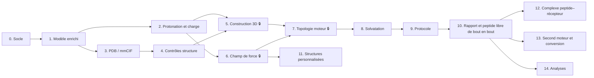

# PepForge — Plan de construction

> Construction de PepForge en étapes courtes, chacune livrée par une PR séparée, revue et testée avant de passer à la suivante. L'architecture cible est décrite dans [ARCHITECTURE.md](ARCHITECTURE.md).

## Mode d'emploi

- **Une étape = une PR** (ou quelques PR si l'étape est longue), sur une branche dédiée, fusionnée seulement quand tous ses critères d'acceptation sont cochés.
- **Définition de « terminé »**, commune à toutes les étapes :
  1. CI verte : `ruff check`, `ruff format --check`, `mypy --strict`, `pytest` sur Python 3.11, 3.12 et 3.13 ;
  2. `tests/test_architecture.py` passe : aucune dépendance interdite ;
  3. toute nouvelle donnée scientifique a sa source (publication, base de données, version) ;
  4. toute opération qui modifie une structure est journalisée ;
  5. `ARCHITECTURE.md` est à jour si un contrat ou un type d'échange a changé ;
  6. le modèle de PR est rempli, et Firas a relu la partie scientifique.
- **Étapes bloquées par une décision** : elles sont marquées 🔒. On peut avancer sur les étapes suivantes qui n'en dépendent pas.
- **Tests** : quatre niveaux (voir [ARCHITECTURE.md, section 7](ARCHITECTURE.md#7-vérification--revue-contrôles-et-tests)). Abréviations ci-dessous : **U** unitaire, **K** contrat, **I** intégration, **V** validation scientifique.

---

## Étape 0 — Socle d'architecture ✅ (cette PR)

**Objectif** : fixer les modules, leurs contrats et les règles de vérification avant d'écrire les fonctionnalités.

**Livrables** : `docs/ARCHITECTURE.md`, ce plan, `core.Structure`, module `checks`, module `build` (interfaces), `EngineWriter` revu (`write_topology`, `solvate`, `EngineFiles`), `ParameterSet` enrichi, `pipeline.Stage` / `run_stage`, `ExternalTool` déplacé dans `tools`, `SolvationSpec`, `tests/test_architecture.py`, `tests/contracts.py`, modèle de PR.

**Critères d'acceptation**

- [x] Chaque module a un rôle, des entrées, des sorties et des interdits écrits.
- [x] La matrice de dépendances est vérifiée automatiquement.
- [x] Chaque interface a une fonction de contrat réutilisable.
- [x] Une étape réelle (`SequenceInputStage`) passe par `run_stage` avec ses contrôles.
- [x] Aucun moteur, champ de force ni paramètre de solvatation par défaut.

**Tests** : U (`test_structure`, `test_checks`, `test_config`), K (`test_interfaces`), architecture (`test_architecture`).

---

## Étape 1 — Modèle de données enrichi

**Objectif** : que `core` puisse représenter tout ce dont les étapes suivantes ont besoin, sans connaître de champ de force.

**Modules** : `core`, `residues`, `io.sequence`.

**Livrables**

- `Peptide` immuable (opérations qui renvoient un nouveau peptide : mutation, changement d'extrémité), chacune journalisée par l'appelant.
- Résidu avec état de protonation optionnel (`protonation: str | None`, clé interne neutre comme `his_delta`, `his_epsilon`, `his_protonated`).
- Modifications de chaînes latérales et liaisons non linéaires (pont disulfure, cyclisation tête-queue) déclarées, même si leur prise en charge complète vient plus tard.
- Notation des non standards dans une séquence (ex. `Ac-RG[Aib]S-NH2`), avec la règle de lecture documentée.

**Critères d'acceptation**

- [ ] Aucun nom de résidu de champ de force dans `core` (vérifié par un test qui cherche `NHE`, `NME`, `HIE`, `HID`, `HIP`, `CYX` dans `src/pepforge/core/`).
- [ ] Une mutation renvoie un nouveau `Peptide` ; l'original est inchangé.
- [ ] Les notations existantes (`Ac-RGDS-NH2`, `NH2-Arg-Gly-CO-NH2`...) donnent le même résultat qu'avant.

**Tests** : U (mutations, notation entre crochets, erreurs) ; V : aucune (pas encore de chimie quantitative).

**Revue** : relire la règle de lecture des séquences ; vérifier que les clés internes de protonation sont neutres.

---

## Étape 2 — Protonation et charge nette théorique

**Objectif** : choisir l'état de chaque groupe ionisable au pH de l'étude et calculer la charge nette théorique, référence de tous les contrôles de charge ultérieurs.

**Modules** : `residues/data/` (nouveau fichier de groupes ionisables), `residues`, `checks`, `pipeline` (étape « normalisation »).

**Prérequis** : choisir la **source** des pKa de référence (valeurs de résidus isolés publiées, ou outil de prédiction comme PROPKA pour une structure). À décider avec Firas ; aucune valeur n'est saisie sans sa source.

**Livrables**

- `residues/data/ionizable_groups.yaml` : groupes ionisables (amine N-terminale, carboxyle C-terminal, Asp, Glu, His, Cys, Tyr, Lys, Arg), charge de chaque état, pKa de référence et sa source.
- Fonction `theoretical_net_charge(peptide, ph) -> float` et choix des états (`assign_protonation(peptide, ph) -> Peptide`).
- Étape `ProtonationStage` et contrôles associés.

**Critères d'acceptation**

- [ ] Une extrémité acétylée ou amidée ne porte pas de charge ; une extrémité libre en porte une selon le pH.
- [ ] Le pH vient de `PrepConfig.ph` ; s'il manque, `ConfigurationError`.
- [ ] Un pH proche d'un pKa (fenêtre définie et justifiée) produit un `WARN` : l'état choisi doit être relu.
- [ ] Le choix de chaque état est journalisé avec la source du pKa.

**Tests** : U (chaque groupe, cas limites de pH) ; I (`SequenceInputStage` puis `ProtonationStage`) ; V : charges nettes des peptides de référence calculées à la main et consignées dans `tests/reference/charges.yaml` avec le raisonnement.

**Revue** : Firas valide la source des pKa et les charges attendues des peptides de référence.

---

## Étape 3 — Lecture et écriture PDB / mmCIF, inventaire

**Objectif** : importer une structure (expérimentale ou issue de docking) et en dresser l'inventaire, sans la modifier.

**Modules** : `io`, `core.structure`.

**Prérequis** : décider de lire les formats nous-mêmes ou via une bibliothèque (gemmi, Biopython...). Recommandation : une bibliothèque éprouvée pour mmCIF, encapsulée dans `io` pour que le reste du code ne voie que `Structure`.

**Livrables** : `io.read_structure(path) -> Structure`, `io.write_pdb(structure, path)`, `inventory(structure) -> StructureInventory` (chaînes, résidus, hétéroatomes, eaux, ions, conformations alternatives, hydrogènes, trous de numérotation).

**Critères d'acceptation**

- [ ] Lecture puis écriture puis relecture sans perte (coordonnées, noms, chaînes).
- [ ] L'inventaire signale tout ce qui demandera une décision (conformations alternatives, résidus manquants, ligands).
- [ ] Aucune correction silencieuse à la lecture.
- [ ] Correspondance `Structure` → `Peptide` quand la structure est un peptide reconnu.

**Tests** : U (petits fichiers PDB et mmCIF écrits à la main dans `tests/data/`) ; I (lecture d'une sortie de docking type) ; V : inventaire d'une structure publique d'un récepteur ciblé, comparé à la description de la PDB.

**Revue** : vérifier la gestion des conformations alternatives et des numéros d'insertion.

---

## Étape 4 — Contrôles de structure

**Objectif** : disposer de tous les contrôles de la section « Structure » de la checklist 04, applicables à n'importe quelle `Structure`.

**Modules** : `checks`, `residues/data/` (atomes attendus par résidu).

**Livrables** : contrôles « résidus attendus », « atomes lourds manquants », « hydrogènes présents », « conformations alternatives résolues », « extrémités conformes au peptide », « stéréochimie des carbones alpha », « chevauchements atomiques ». Données des atomes attendus tirées d'une source publiée (ex. dictionnaire des composants chimiques de la PDB), avec la version.

**Critères d'acceptation**

- [ ] Chaque item automatisable de la section « Structure » de la checklist 04 a un contrôle et l'indique dans `checklist_item`.
- [ ] Chaque contrôle a un test `PASS` et un test `FAIL`.
- [ ] Les seuils (distance de chevauchement...) viennent d'un fichier de données sourcé, pas du code.

**Tests** : U (structures construites à la main, correctes et volontairement défectueuses) ; V : structures publiques connues.

**Revue** : Firas relit les seuils et leurs sources.

---

## Étape 5 — Construction et correction 3D 🔒

**Décision requise** : outil de construction (ex. `tleap` d'AmberTools, constructeur Python, autre). Le choix n'affecte que `build`.

**Objectif** : produire une `Structure` à partir d'un `Peptide` (conformation étendue ou hélicoïdale) et corriger une structure importée (atomes manquants, hydrogènes selon la protonation de l'étape 2).

**Modules** : `build`, `tools` (si l'outil est externe).

**Livrables** : un `StructureBuilder`, des `StructureModifier` (sélection de chaîne, résolution des conformations alternatives, ajout d'atomes manquants, ajout des hydrogènes, mutation), étapes du pipeline correspondantes.

**Critères d'acceptation**

- [ ] `assert_builder_contract` passe.
- [ ] Tous les contrôles de l'étape 4 passent sur les peptides de référence construits.
- [ ] Extrémités conservées (vérifié par contrôle et par test).
- [ ] Chaque modification d'une structure importée est journalisée.

**Tests** : K, U, I (séquence → protonation → construction) ; V : géométrie (longueurs de liaison, angles dièdres de la conformation demandée) comparée à des valeurs de référence sourcées ; tests marqués `external` si un outil externe est utilisé.

**Revue** : inspection visuelle d'au moins une structure par peptide de référence (PyMOL ou VMD), consignée dans la PR.

---

## Étape 6 — Premier adaptateur de champ de force 🔒

**Décision requise** : champ de force principal (ff14SB, ff19SB, CHARMM36m...) et modèle d'eau associé.

**Objectif** : traduire un `Peptide` protoné dans la nomenclature du champ de force et produire un `ParameterSet` complet et sourcé.

**Modules** : `forcefields`, `forcefields/data/`.

**Livrables** : un adaptateur, ses tables de correspondance (résidus, extrémités, tautomères) avec leur source, la liste des modèles d'eau compatibles avec la publication qui l'établit.

**Critères d'acceptation**

- [ ] `assert_forcefield_contract` passe sur tous les peptides de référence.
- [ ] `-CO-NH2` donne `NHE` et `-CO-NH-CH3` donne `NME` en AMBER (ou l'équivalent documenté dans un autre champ de force) ; test dédié.
- [ ] Un résidu sans paramètres lève `MissingParameterError`.
- [ ] Un modèle d'eau incompatible lève `ConfigurationError`.

**Tests** : K, U (chaque correspondance) ; V : règle 7 de `CLAUDE.md`, charge nette et absence de paramètre manquant pour chaque résidu pris en charge.

**Revue** : Firas vérifie les correspondances de nomenclature et les citations.

---

## Étape 7 — Topologie pour un premier moteur 🔒

**Décision requise** : moteur principal.

**Objectif** : écrire topologie, paramètres et coordonnées du soluté dans le vide.

**Modules** : `engines`, `tools`.

**Livrables** : un `EngineWriter` (`write_topology`), les motifs d'échec de l'outil utilisé (`failure_patterns`), les contrôles de l'étape 5 du pipeline (charge nette relue, nombre d'atomes, résidus terminaux).

**Critères d'acceptation**

- [ ] `assert_engine_writer_contract` passe.
- [ ] Charge nette **relue dans les fichiers produits** égale à la charge théorique de l'étape 2.
- [ ] Toute ligne d'avertissement de l'outil fait échouer l'étape, sauf exception documentée.
- [ ] Versions des outils dans `EngineFiles.tool_versions`.

**Tests** : K, U (génération des scripts d'entrée de l'outil), I (séquence → topologie, marqué `external`) ; V : énergie en point unique d'un peptide de référence comparée à un calcul fait à la main avec l'outil, consigné dans `tests/reference/`.

**Revue** : relire les fichiers d'entrée générés (scripts tleap, gmx ou psfgen).

---

## Étape 8 — Solvatation et neutralisation

**Objectif** : boîte, eau, contre-ions et sel selon `SolvationSpec`.

**Modules** : `engines` (`solvate`), `checks`, `config`.

**Critères d'acceptation**

- [ ] `SolvationSpec.missing_decisions()` vide, sinon `ConfigurationError` avant tout calcul.
- [ ] Système neutre ; concentration en sel conforme ; marge de boîte respectée ; aucun chevauchement (contrôles de la section « Système solvaté » de la checklist 04).
- [ ] Les choix (marge, sel) sont justifiés dans `PrepConfig.notes` et reportés dans le rapport.

**Tests** : U, I (marqués `external`) ; V : nombre d'ions calculé à la main pour un volume donné.

---

## Étape 9 — Protocole de simulation

**Objectif** : scripts de minimisation, d'équilibration (NVT puis NPT) et de production.

**Modules** : `config` (nouveau `ProtocolSpec`, sans valeur par défaut), `engines` (`write_protocol`), `engines/data/` (modèles de scripts commentés).

**Critères d'acceptation**

- [ ] Aucune valeur numérique dans le code : températures, durées, pas de temps, rayons de coupure viennent de `ProtocolSpec`, chacun avec sa justification.
- [ ] Contrôles de la section « Protocole de simulation » de la checklist 04 (pas d'intégration cohérent avec les contraintes sur les liaisons hydrogène, électrostatique longue portée déclarée, plusieurs répliques).
- [ ] Les scripts produits se terminent par leurs propres contrôles (règle 5 de `CLAUDE.md`).

**Tests** : U (rendu des modèles), V : exécution courte de chaque script sur un peptide de référence (marqué `external`, hors CI si trop long).

---

## Étape 10 — Rapport reproductible et peptide libre de bout en bout

**Objectif** : la commande `pepforge prepare config.yaml` enchaîne toutes les étapes pour un **peptide libre en solution** et produit un rapport rejouable.

**Modules** : `report`, `pipeline`, `cli`.

**Critères d'acceptation**

- [ ] Le rapport contient : configuration complète, journal, résultats de tous les contrôles, versions des outils, objectif de simulation, points à vérifier manuellement.
- [ ] Relancer avec le YAML du rapport donne des fichiers identiques (hors horodatages).
- [ ] Un échec à n'importe quelle étape produit un rapport partiel lisible.

**Tests** : I de bout en bout sur `Ac-RGDS-NH2` ; test de reproductibilité (deux exécutions, fichiers comparés) ; V : courte simulation lancée et relue par Firas.

---

## Étape 11 — Structures chimiques personnalisées

**Objectif** : intégrer un résidu ou une modification absente des champs de force (mode d'entrée 2.3 de la spécification).

**Modules** : `io` (SMILES, MOL/SDF), `forcefields` (dérivation : GAFF2 via `antechamber`/`parmchk2` pour AMBER, CGenFF pour CHARMM), `residues` (bibliothèque locale versionnée), `checks`.

**Décision requise** : bibliothèque chimique (RDKit ou autre) et méthode de calcul des charges (niveau de calcul quantique, ajustement RESP, AM1-BCC...).

**Critères d'acceptation**

- [ ] Vérification de la valence, de la stéréochimie et de la protonation du fragment.
- [ ] Points d'ancrage dans la chaîne déclarés explicitement.
- [ ] Tout paramètre obtenu par analogie est signalé avec son niveau de confiance (pénalités CGenFF, avertissements `parmchk2`).
- [ ] Le résidu produit est réutilisable et porte sa procédure de dérivation complète.

**Tests** : K, U ; V : règle 7 (charge nette, aucun paramètre manquant) et comparaison avec un résidu dont les paramètres sont publiés.

---

## Étape 12 — Complexe peptide–récepteur

**Objectif** : préparer le récepteur (DCC, TrkC, UNC5), placer le peptide issu du docking, paramétrer l'ensemble.

**Modules** : `core` (plusieurs chaînes), `io`, `build`, `pipeline` (variante de chaîne selon `PrepConfig.goal`).

**Critères d'acceptation**

- [ ] `goal = peptide_receptor_complex` sans récepteur : `ConfigurationError`.
- [ ] Le récepteur passe les mêmes contrôles de structure que le peptide.
- [ ] La taille de boîte et le protocole tiennent compte de l'objectif ; les deux scénarios ne partagent pas de valeurs implicites.

**Tests** : I sur un complexe de référence ; V : relecture de l'interface et des contacts par Firas.

---

## Étape 13 — Second moteur, second champ de force, conversion

**Objectif** : prouver que l'architecture tient : ajouter un moteur ou un champ de force sans modifier les modules existants, et convertir entre moteurs.

**Critères d'acceptation**

- [ ] L'ajout ne modifie ni `core`, ni `build`, ni les autres adaptateurs (vérifiable dans le diff de la PR).
- [ ] Conversion traitée comme une étape distincte : nombre d'atomes, charge nette et énergie en point unique comparés avant et après.

**Tests** : K pour la nouvelle implémentation ; V : comparaison croisée des énergies entre moteurs.

---

## Étape 14 — Analyses

**Objectif** : analyses de la section 7 de la spécification (RMSD, RMSF, rayon de giration, structure secondaire, liaisons hydrogène, SASA, contacts d'interface, regroupement).

**Architecture** : nouveau module `analysis`, hors de la chaîne de préparation. Il consomme des trajectoires et le rapport de préparation, et ne dépend que de `core`, `config`, `io` et `report`. À déclarer dans la matrice de dépendances.

**Tests** : U sur des trajectoires synthétiques ; V : comparaison avec un outil d'analyse publié sur une même trajectoire.
