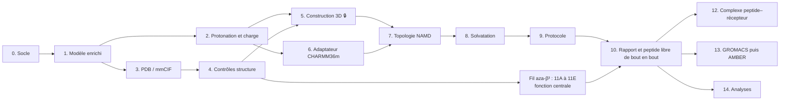

# PepForge — Plan de construction

> Construction de PepForge en étapes courtes, chacune livrée par une PR séparée, revue et testée avant de passer à la suivante. L'architecture cible est décrite dans [ARCHITECTURE.md](ARCHITECTURE.md).

## Mode d'emploi

- **Une étape = une PR** (ou quelques PR si l'étape est longue), sur une branche dédiée, fusionnée seulement quand tous ses critères d'acceptation sont cochés.
- **Définition de « terminé »**, commune à toutes les étapes :
  1. CI verte : `ruff check`, `ruff format --check`, `mypy --strict`, `pytest` sur Python 3.11, 3.12 et 3.13 ;
  2. `tests/test_architecture.py` passe : aucune dépendance interdite ;
  3. toute nouvelle donnée scientifique a sa source (publication, base de données, version) ;
  4. toute opération qui modifie une structure est journalisée ;
  5. `ARCHITECTURE.md` est à jour si un contrat ou un type d'échange a changé ;
  6. le modèle de PR est rempli, et Firas a relu la partie scientifique.
- **Étapes bloquées par une décision** : elles sont marquées 🔒. On peut avancer sur les étapes suivantes qui n'en dépendent pas.
- **Tests** : quatre niveaux (voir [ARCHITECTURE.md, section 7](ARCHITECTURE.md#7-vérification--revue-contrôles-et-tests)). Abréviations ci-dessous : **U** unitaire, **K** contrat, **I** intégration, **V** validation scientifique.

## Méthode de travail imposée (Firas, 27 novembre 2026)

Quatre phases, dans cet ordre, et **une progression module par module**.

1. **Architecture et conception** — objectifs, architecture globale, modules et responsabilités, interfaces et formats d'échange, dépendances, organisation des fichiers, et documentation des choix architecturaux **et scientifiques**. *Livré : [ARCHITECTURE.md](ARCHITECTURE.md) et ce plan.*
2. **Développement** — les modules un par un, dans l'ordre du plan, en respectant les responsabilités et les interfaces déjà définies. **Pas deux modules à la fois sans nécessité, et pas de module suivant avant que le précédent soit terminé.**
3. **Tests et validation scientifique** — pour chaque module : tests unitaires, interactions avec les autres composants quand c'est applicable, conformité aux spécifications, validation scientifique propre à sa fonction, comparaison aux références et aux logiciels de référence quand c'est pertinent, et documentation des résultats, des limites et des anomalies.
4. **DevOps et distribution** — intégration et tests continus, environnement et dépendances, gestion des versions, documentation technique et utilisateur, distribution des versions stables.

> **Un module n'est jamais validé au motif que son code s'exécute sans erreur.** C'est la même exigence que la politique d'absence d'erreur silencieuse ([ARCHITECTURE.md, section 17](ARCHITECTURE.md#17-politique-dabsence-derreur-silencieuse)) : un code de retour nul ne prouve rien.

### Le cycle obligatoire de chaque module

1. Présenter l'objectif et les responsabilités du module.
2. Définir sa conception technique.
3. Développer son code.
4. Exécuter les tests.
5. Effectuer sa validation scientifique, si elle s'applique.
6. Documenter les résultats.
7. Déclarer explicitement le statut du module.

Puis **s'arrêter et attendre l'instruction de Firas.** Aucun enchaînement automatique vers le module suivant : Firas contrôle chaque étape, examine les résultats et confirme la poursuite.

### Le bilan de fin de module

À produire à la fin de chaque module, dans cet ordre :

- nom et numéro du module ;
- fonctionnalités développées ;
- fichiers créés ou modifiés ;
- tests effectués et résultats obtenus ;
- validation scientifique et références utilisées ;
- problèmes connus et limitations ;
- **statut final** : `TERMINÉ ET VALIDÉ`, `TERMINÉ MAIS NON VALIDÉ` ou `INCOMPLET`.

Chaque bilan est conservé dans [`docs/bilans/`](bilans/), un fichier par module, et lié depuis l'étape correspondante de ce plan.

### Règles générales

- Ne pas anticiper le développement des modules futurs.
- Ne pas modifier l'architecture globale sans **justifier et documenter** la modification.
- Ne jamais inventer de résultat de test ou de validation.
- Ne masquer ni erreur ni limitation.
- Préserver la compatibilité entre modules.
- Git et commits structurés, pour la traçabilité.
- Privilégier la fiabilité scientifique et la reproductibilité plutôt que la rapidité.

### Un écart assumé sur la phase 4

La phase 4 place l'intégration continue après le développement. Elle est **déjà en place** depuis l'étape 0, et tourne sur Linux et Windows ([ARCHITECTURE.md, section 19.5](ARCHITECTURE.md#195-comment-on-sassure-que-cest-vrai)). La garder en avance est délibéré : sans elle, chaque module serait déclaré terminé sans preuve que rien n'a cassé ailleurs, ce qui contredirait la règle de fiabilité de la phase 3. Ce qui reste bien en phase 4 : l'empaquetage, la gestion des versions, la documentation utilisateur et la distribution (étape 15).

---

> **Fil central, ajouté le 26 novembre 2026.** La fonction centrale de PepForge est la substitution d'un acide aminé par un résidu **aza-β³**, pour n'importe quel acide aminé et n'importe quelle position, suivie de la génération des fichiers de dynamique moléculaire (voir [ARCHITECTURE.md, section 10](ARCHITECTURE.md#10-cas-dusage-central--substituer-un-acide-aminé-par-un-résidu-aza-β³)). Les étapes 11A à 11E ci-dessous portent ce fil. Elles ne sont plus une extension tardive : dès que l'étape 4 est passée, le fil aza-β³ avance **en parallèle** des étapes 5 à 10, parce que la dérivation des paramètres est l'étape la plus longue et la plus risquée du projet. L'étape 10 (bout en bout) doit être démontrée sur un **pseudopeptide aza-β³**, et pas seulement sur un peptide standard.

---

## Étape 0 — Socle d'architecture ✅ (cette PR)

**Objectif** : fixer les modules, leurs contrats et les règles de vérification avant d'écrire les fonctionnalités.

**Livrables** : `docs/ARCHITECTURE.md`, ce plan, `core.Structure`, module `checks` **dont la comparaison d'inventaires** (`checks.inventory`, mécanisme central de l'absence d'erreur silencieuse, section 17), module `build` (interfaces), `EngineWriter` revu (`write_topology`, `solvate`, `EngineFiles`), `ParameterSet` enrichi, `pipeline.Stage` / `run_stage`, `ExternalTool` déplacé dans `tools`, `SolvationSpec`, `tests/test_architecture.py`, `tests/contracts.py`, modèle de PR.

**Critères d'acceptation**

- [x] Chaque module a un rôle, des entrées, des sorties et des interdits écrits.
- [x] La matrice de dépendances est vérifiée automatiquement.
- [x] Chaque interface a une fonction de contrat réutilisable.
- [x] Une étape réelle (`SequenceInputStage`) passe par `run_stage` avec ses contrôles.
- [x] Aucun moteur, champ de force ni paramètre de solvatation par défaut.
- [x] Le mécanisme d'inventaire attendu contre fichier produit est implémenté et testé, avec un test par piège du catalogue 17.2, et un champ non vérifiable échoue au lieu de passer.

**Tests** : U (`test_structure`, `test_checks`, `test_config`, `test_inventory`), K (`test_interfaces`), architecture (`test_architecture`). 92 tests au total.

---

## Étape 1 — Modèle de données enrichi

**Statut : TERMINÉ ET VALIDÉ.** Code, tests et documentation livrés le 27 novembre 2026 (commits `1aa6b0a` à `d8ef025`), CI verte sur Linux et Windows. Revue de Firas faite le même jour, en deux temps (bilan, sections 9 et 10), puis validation : il a demandé de passer au module 2 (bilan, section 10.7). Bilan complet : [bilans/module-01-modele-de-donnees.md](bilans/module-01-modele-de-donnees.md).

**Objectif** : que `core` puisse représenter tout ce dont les étapes suivantes ont besoin, sans connaître de champ de force.

**Modules** : `core`, `residues`, `io.sequence`. *Réalisé : `core` et `io.sequence` ; `checks`, `exceptions` et `cli` ajustés pour la compatibilité, sans quoi une déclaration aurait traversé les contrôles et l'inventaire sans être vue. À la revue : `residues` (forme écrite des extrémités), `config` (`sequence_notation`) et `pipeline` (mode de lecture de `SequenceInputStage`).*

**Livrables**

- `Peptide` immuable (opérations qui renvoient un nouveau peptide : mutation, changement d'extrémité), chacune journalisée par l'appelant.
- Résidu avec état de protonation optionnel (`protonation: str | None`, clé interne neutre comme `his_delta`, `his_epsilon`, `his_protonated`).
- Modifications de chaînes latérales et liaisons non linéaires (pont disulfure, cyclisation tête-queue) déclarées, même si leur prise en charge complète vient plus tard.
- Notation des non standards dans une séquence (ex. `Ac-RG[Aib]S-NH2`), avec la règle de lecture documentée.
- *Ajouté à la revue (demande de Firas) : mode de lecture déclaré au départ, code à une lettre ou code à trois lettres, sans valeur par défaut ; conversion d'une séquence entre les deux codes, à la manière de PyMOL.*

**Critères d'acceptation**

- [x] Aucun nom de résidu de champ de force dans `core` (vérifié par un test qui cherche `NHE`, `NME`, `HIE`, `HID`, `HIP`, `CYX` dans `src/pepforge/core/`). *Le test cherche aussi seize autres noms AMBER et CHARMM, et il attrape bien ceux de l'ancienne version de `core`.*
- [x] Une mutation renvoie un nouveau `Peptide` ; l'original est inchangé.
- [x] Les notations existantes (`Ac-RGDS-NH2`, `NH2-Arg-Gly-CO-NH2`...) donnent le même résultat qu'avant. *Les 49 tests des fichiers existants, dans leur version d'avant l'étape, réussissent sur le nouveau code. Depuis la revue, ces notations donnent le même résultat une fois le mode de lecture déclaré ; seule la lecture devinée d'un bloc comme `ALA` a disparu.*

**Tests** : U (mutations, notation entre crochets, erreurs) ; V : aucune (pas encore de chimie quantitative). *Réalisé : 97 tests ajoutés, 209 au total ; 9 défauts injectés volontairement sur 9 détectés. Après la revue : 333 tests ; 16 défauts injectés sur 16 détectés pour le mode de lecture et la conversion.*

**Revue** : relire la règle de lecture des séquences ; vérifier que les clés internes de protonation sont neutres. *Faite par Firas le 27 novembre 2026 : règle de lecture et clés de protonation approuvées, refus de mutation conservé. Deuxième retour le même jour : le mode de lecture se déclare au départ et une conversion entre les deux codes est ajoutée, ce qui remplace l'avertissement de lecture ambiguë (bilan, section 10). Ces ajouts et l'item « liaisons hors squelette » de la checklist 04 (bilan, section 9) sont validés avec le module.*

---

## Étape 2 — Protonation et charge nette théorique

**Statut : TERMINÉ MAIS NON VALIDÉ.** Code, tests et documentation livrés le 27 novembre 2026 sur une branche et une PR dédiées. Source des pKa choisie par Firas (pentapeptides d'alanine) ; la validation attend sa relecture des charges de référence, et le pKa de l'arginine reste à saisir. Bilan complet : [bilans/module-02-protonation.md](bilans/module-02-protonation.md).

**Objectif** : choisir l'état de chaque groupe ionisable au pH de l'étude et calculer la charge nette théorique, référence de tous les contrôles de charge ultérieurs.

**Modules** : `residues/data/` (nouveau fichier de groupes ionisables), `residues`, `checks`, `pipeline` (étape « normalisation »).

**Prérequis** : choisir la **source** des pKa de référence (valeurs de résidus isolés publiées, ou outil de prédiction comme PROPKA pour une structure). À décider avec Firas ; aucune valeur n'est saisie sans sa source. *Décidé par Firas le 27 novembre 2026 : pKa mesurés sur des pentapeptides d'alanine (Thurlkill et al. 2006, tableau I de Grimsley et al. 2009). PROPKA pourra s'ajouter comme seconde source, sur structure, après l'étape 3.*

**Livrables**

- `residues/data/ionizable_groups.yaml` : groupes ionisables (amine N-terminale, carboxyle C-terminal, Asp, Glu, His, Cys, Tyr, Lys, Arg), charge de chaque état, pKa de référence et sa source.
- Fonction `theoretical_net_charge(peptide, ph) -> float` et choix des états (`assign_protonation(peptide, ph) -> Peptide`).
- Étape `ProtonationStage` et contrôles associés.

**Critères d'acceptation**

- [x] Une extrémité acétylée ou amidée ne porte pas de charge ; une extrémité libre en porte une selon le pH.
- [x] Le pH vient de `PrepConfig.ph` ; s'il manque, `ConfigurationError`.
- [x] Un pH proche d'un pKa (fenêtre définie et justifiée) produit un `WARN` : l'état choisi doit être relu. *Fenêtre : \|pH − pKa\| < 1, justifiée par Henderson–Hasselbalch dans le fichier de données (forme minoritaire au-delà de 9 %), à confirmer par Firas.*
- [x] Le choix de chaque état est journalisé avec la source du pKa.

**Tests** : U (chaque groupe, cas limites de pH) ; I (`SequenceInputStage` puis `ProtonationStage`) ; V : charges nettes des peptides de référence calculées à la main et consignées dans `tests/reference/charges.yaml` avec le raisonnement.

**Revue** : Firas valide la source des pKa et les charges attendues des peptides de référence. *Source validée le 27 novembre 2026 ; charges de référence (`tests/reference/charges.yaml`) à relire.*

---

## Étape 3 — Lecture et écriture PDB / mmCIF, inventaire

**Objectif** : importer une structure (expérimentale ou issue de docking) et en dresser l'inventaire, sans la modifier.

**Modules** : `io`, `core.structure`.

**Prérequis** : décider de lire les formats nous-mêmes ou via une bibliothèque (gemmi, Biopython...). Recommandation : une bibliothèque éprouvée pour mmCIF, encapsulée dans `io` pour que le reste du code ne voie que `Structure`.

**Livrables** : `io.read_structure(path) -> Structure`, `io.write_pdb(structure, path)`, `inventory(structure) -> StructureInventory` (chaînes, résidus, hétéroatomes, eaux, ions, conformations alternatives, hydrogènes, trous de numérotation).

**Critères d'acceptation**

- [ ] Lecture puis écriture puis relecture sans perte (coordonnées, noms, chaînes).
- [ ] L'inventaire signale tout ce qui demandera une décision (conformations alternatives, résidus manquants, ligands).
- [ ] Aucune correction silencieuse à la lecture.
- [ ] Correspondance `Structure` → `Peptide` quand la structure est un peptide reconnu.

**Tests** : U (petits fichiers PDB et mmCIF écrits à la main dans `tests/data/`) ; I (lecture d'une sortie de docking type) ; V : inventaire d'une structure publique d'un récepteur ciblé, comparé à la description de la PDB.

**Revue** : vérifier la gestion des conformations alternatives et des numéros d'insertion.

---

## Étape 4 — Contrôles de structure

**Objectif** : disposer de tous les contrôles de la section « Structure » de la checklist 04, applicables à n'importe quelle `Structure`.

**Modules** : `checks`, `residues/data/` (atomes attendus par résidu).

**Livrables** : contrôles « résidus attendus », « atomes lourds manquants », « hydrogènes présents », « conformations alternatives résolues », « extrémités conformes au peptide », « stéréochimie des carbones alpha », « chevauchements atomiques ». Données des atomes attendus tirées d'une source publiée (ex. dictionnaire des composants chimiques de la PDB), avec la version.

**Critères d'acceptation**

- [ ] Chaque item automatisable de la section « Structure » de la checklist 04 a un contrôle et l'indique dans `checklist_item`.
- [ ] Les lignes du catalogue de la [section 17.2](ARCHITECTURE.md#172-catalogue-des-défaillances-silencieuses) relevant de la lecture PDB sont couvertes : conformations alternatives résolues, continuité de la chaîne, atomes manquants.
- [ ] Chaque contrôle a un test `PASS` et un test `FAIL`.
- [ ] Les seuils (distance de chevauchement...) viennent d'un fichier de données sourcé, pas du code.

**Tests** : U (structures construites à la main, correctes et volontairement défectueuses) ; V : structures publiques connues.

**Revue** : Firas relit les seuils et leurs sources.

---

## Étape 5 — Construction et correction 3D 🔒

**Décision requise** : outil de construction (ex. `tleap` d'AmberTools, constructeur Python, autre). Le choix n'affecte que `build`.

**Objectif** : produire une `Structure` à partir d'un `Peptide` (conformation étendue ou hélicoïdale) et corriger une structure importée (atomes manquants, hydrogènes selon la protonation de l'étape 2).

**Modules** : `build`, `tools` (si l'outil est externe).

**Livrables** : un `StructureBuilder`, des `StructureModifier` (sélection de chaîne, résolution des conformations alternatives, ajout d'atomes manquants, ajout des hydrogènes, mutation), étapes du pipeline correspondantes.

**Critères d'acceptation**

- [ ] `assert_builder_contract` passe.
- [ ] Tous les contrôles de l'étape 4 passent sur les peptides de référence construits.
- [ ] Extrémités conservées (vérifié par contrôle et par test).
- [ ] Chaque modification d'une structure importée est journalisée.

**Tests** : K, U, I (séquence → protonation → construction) ; V : géométrie (longueurs de liaison, angles dièdres de la conformation demandée) comparée à des valeurs de référence sourcées ; tests marqués `external` si un outil externe est utilisé.

**Revue** : inspection visuelle d'au moins une structure par peptide de référence (PyMOL ou VMD), consignée dans la PR.

---

## Étape 6 — Adaptateur CHARMM36m

**Champ de force retenu : CHARMM36m + CGenFF**, confirmé par Firas le 26 novembre 2026, cohérent avec NAMD. Modèle d'eau : TIP3P modifié CHARMM. Les fichiers à produire (`.rtf`, `.prm`, `.str`, `.psf`) et les deux pièges à éviter sont décrits en [ARCHITECTURE.md, section 11.3](ARCHITECTURE.md#113-les-fichiers-charmm-et-namd-à-produire).

**Objectif** : traduire un `Peptide` protoné dans la nomenclature du champ de force et produire un `ParameterSet` complet et sourcé.

**Modules** : `forcefields`, `forcefields/data/`.

**Livrables** : un adaptateur, ses tables de correspondance (résidus, extrémités, tautomères) avec leur source, la liste des modèles d'eau compatibles avec la publication qui l'établit.

**Critères d'acceptation**

- [ ] `assert_forcefield_contract` passe sur tous les peptides de référence.
- [ ] `-CO-NH2` donne `NHE` et `-CO-NH-CH3` donne `NME` en AMBER (ou l'équivalent documenté dans un autre champ de force) ; test dédié.
- [ ] Un résidu sans paramètres lève `MissingParameterError`.
- [ ] Un modèle d'eau incompatible lève `ConfigurationError`.

**Tests** : K, U (chaque correspondance) ; V : règle 7 de `CLAUDE.md`, charge nette et absence de paramètre manquant pour chaque résidu pris en charge.

**Revue** : Firas vérifie les correspondances de nomenclature et les citations.

---

## Étape 7 — Topologie pour NAMD

**Moteur retenu : NAMD**, d'après le projet de thèse (NAMD pour l'affinement des modèles, la dynamique moléculaire et la minimisation d'énergie, VMD pour l'outillage). Fichiers visés : `.psf` et `.pdb` via `psfgen`, plus les `.prm`, `.rtf` et `.str` du champ de force. Rappel : un `.str` CHARMM est un *stream file* de topologie et de paramètres, pas un fichier de coordonnées.

**Objectif** : écrire topologie, paramètres et coordonnées du soluté dans le vide.

**Modules** : `engines`, `tools`.

**Livrables** : un `EngineWriter` (`write_topology`), les motifs d'échec de l'outil utilisé (`failure_patterns`), les contrôles de l'étape 5 du pipeline (charge nette relue, nombre d'atomes, résidus terminaux).

**Critères d'acceptation**

- [ ] `assert_engine_writer_contract` passe.
- [ ] Charge nette **relue dans les fichiers produits** égale à la charge théorique de l'étape 2.
- [ ] Toute ligne d'avertissement de l'outil fait échouer l'étape, sauf exception inscrite dans une liste versionnée, motivée avec la version de l'outil, et reportée dans le rapport ([section 17.3](ARCHITECTURE.md#173-les-avertissements-sont-des-erreurs)).
- [ ] **Inventaire attendu contre fichier produit** : l'inventaire construit depuis le `Peptide` et le `ParameterSet` (atomes par résidu, ordre des résidus, liaisons du squelette, extrémités, ponts disulfure, charge nette, nombre de termes CMAP attendus) est comparé à celui relu dans le `.psf` réellement produit. Toute différence lève `QualityCheckError` ([section 17.1](ARCHITECTURE.md#171-le-principe--ne-jamais-croire-loutil-sur-parole)).
- [ ] Un peptide portant une déclaration que l'écrivain ne sait pas traiter (cyclisation tête-queue, modification de chaîne latérale...) est **refusé explicitement** (`UnsupportedFeatureError`), jamais écrit sans elle. `expected_from_peptide` refuse déjà ces deux cas depuis l'étape 1 ; l'étape 7 garde ce refus tant qu'elle ne les prend pas en charge.
- [ ] Les motifs d'échec de `ExternalTool` sont **construits et vérifiés contre l'outil réellement installé**, en provoquant délibérément chaque erreur pour observer ce qu'il affiche. Ils ne sont jamais écrits d'avance.
- [ ] Les contrôles du catalogue de la [section 17.2](ARCHITECTURE.md#172-catalogue-des-défaillances-silencieuses) applicables à cette étape sont implémentés, chacun avec son test `PASS` et son test `FAIL`.
- [ ] Contrôles de dernier recours : charge nette relue, **énergie en point unique** sur le système produit, et minimisation courte qui doit converger. Les trois valeurs sont consignées dans le rapport.
- [ ] Versions des outils dans `EngineFiles.tool_versions`.

**Tests** : K, U (génération des scripts d'entrée de l'outil), I (séquence → topologie, marqué `external`) ; V : énergie en point unique d'un peptide de référence comparée à un calcul fait à la main avec l'outil, consigné dans `tests/reference/`.

**Revue** : relire les fichiers d'entrée générés (scripts tleap, gmx ou psfgen).

---

## Étape 8 — Solvatation et neutralisation

**Objectif** : boîte, eau, contre-ions et sel selon `SolvationSpec`.

**Modules** : `engines` (`solvate`), `checks`, `config`.

**Critères d'acceptation**

- [ ] `SolvationSpec.missing_decisions()` vide, sinon `ConfigurationError` avant tout calcul.
- [ ] Système neutre ; concentration en sel conforme ; marge de boîte respectée ; aucun chevauchement (contrôles de la section « Système solvaté » de la checklist 04).
- [ ] Les choix (marge, sel) sont justifiés dans `PrepConfig.notes` et reportés dans le rapport.

**Tests** : U, I (marqués `external`) ; V : nombre d'ions calculé à la main pour un volume donné.

---

## Étape 9 — Protocole de simulation

**Objectif** : scripts de minimisation, d'équilibration (NVT puis NPT) et de production.

**Modules** : `config` (nouveau `ProtocolSpec`, sans valeur par défaut), `engines` (`write_protocol`), `engines/data/` (modèles de scripts commentés).

**Critères d'acceptation**

- [ ] Aucune valeur numérique dans le code : températures, durées, pas de temps, rayons de coupure viennent de `ProtocolSpec`, chacun avec sa justification.
- [ ] Durées de production et nombre de répliques choisis en fonction du **débit réel du matériel disponible** ([section 16.5](ARCHITECTURE.md#165-le-vrai-poste-de-calcul-cest-la-dynamique)), et non recopiés d'articles utilisant des calculateurs. Le matériel est consigné dans le rapport.
- [ ] Contrôles de la section « Protocole de simulation » de la checklist 04 (pas d'intégration cohérent avec les contraintes sur les liaisons hydrogène, électrostatique longue portée déclarée, plusieurs répliques).
- [ ] Les scripts produits se terminent par leurs propres contrôles (règle 5 de `CLAUDE.md`).

**Tests** : U (rendu des modèles), V : exécution courte de chaque script sur un peptide de référence (marqué `external`, hors CI si trop long).

---

## Étape 10 — Rapport reproductible et peptide libre de bout en bout

**Objectif** : la commande `pepforge prepare config.yaml` enchaîne toutes les étapes pour un **peptide libre en solution** et produit un rapport rejouable.

**Modules** : `report`, `pipeline`, `cli`.

**Critères d'acceptation**

- [ ] Le rapport contient : configuration complète, journal, résultats de tous les contrôles, versions des outils, objectif de simulation, points à vérifier manuellement.
- [ ] Relancer avec le YAML du rapport donne des fichiers identiques (hors horodatages).
- [ ] Un échec à n'importe quelle étape produit un rapport partiel lisible.
- [ ] La séquence de la configuration est lue dans le mode déclaré (`PrepConfig.sequence_notation`), jamais deviné.

**Tests** : I de bout en bout sur `Ac-RGDS-NH2` **et sur son analogue aza-β³ en une position** (dès que l'étape 11C est passée) ; test de reproductibilité (deux exécutions, fichiers comparés) ; V : courte simulation lancée et relue par Firas.

---

## Fil aza-β³ — étapes 11A à 11E (fonction centrale)

Ce fil réalise la substitution d'un acide aminé par un résidu aza-β³ et la paramétrisation qui va avec. Il démarre dès l'étape 4 passée, en parallèle des étapes 5 à 10.

> **Préalable, avant toute ligne de code : bibliographie.** Déterminer la variante exacte visée (aza-β³ `-NH-N(R)-CH2-CO-` ou azapeptide α `-NH-N(R)-CO-`), et chercher s'il existe des paramètres publiés pour des aza-peptides ou des β-peptides réutilisables, à quel niveau de théorie, et avec quelle validation conformationnelle. Livrable : une note dans `docs/` avec les références, la voie retenue et le **niveau de théorie quantique** à fixer pour toute la bibliothèque, relue par Firas. Aucun paramètre n'est écrit dans le dépôt sans sa source ou sa procédure de dérivation complète.

### Étape 11A — Fragment chimique et template de résidu

**Modules** : `core` (`ResidueTemplate`), `io` (SMILES, MOL/SDF), `checks`.

**Décision requise** : bibliothèque chimique (RDKit ou autre).

**Livrables** : type `ResidueTemplate` (fragment, atomes d'ancrage côté N et côté C, atomes retirés au greffage, charge attendue), lecture d'un fragment depuis SMILES ou SDF, contrôles de valence, de stéréochimie et de protonation du fragment.

**Critères d'acceptation**

- [ ] Les points d'ancrage sont déclarés explicitement, jamais devinés.
- [ ] Un fragment de valence incohérente lève `ChemistryError`.
- [ ] Le template ne contient aucun paramètre de champ de force : c'est de la chimie, pas de la paramétrisation.

**Tests** : U (fragments corrects et défectueux) ; K.

### Étape 11B — Greffage dans le peptide

**Modules** : `build` (`MutateResidue`), `checks`, `pipeline`.

**Livrables** : substitution du résidu en position i par un `ResidueTemplate`, reconstruction des liaisons de jonction, minimisation locale du voisinage, journalisation complète.

**Critères d'acceptation**

- [ ] Le squelette reste continu après greffage (contrôle de connectivité, et non un comptage d'atomes supposé).
- [ ] Le reste de la structure est inchangé hors de la zone minimisée, et les extrémités du peptide sont conservées.
- [ ] La longueur et les angles de la liaison N–N tombent dans une plage issue d'une source citée.
- [ ] Les contrôles de stéréochimie attendent un Cα chiral sur les résidus α et aucun centre stéréogène sur le résidu aza.
- [ ] Chaque substitution est journalisée : position, résidu retiré, template ajouté, paramètres de minimisation.

**Tests** : U, K, I (séquence → protonation → construction → substitution) ; V : inspection visuelle de chaque peptide de référence substitué, consignée dans la PR.

### Étape 11C — Dérivation des paramètres d'un résidu aza-β³ 🔒

**Décisions requises** : voie de paramétrisation (AMBER + GAFF2 ou CHARMM + CGenFF), méthode de charges et niveau de théorie, logiciel de calcul quantique disponible.

**Modules** : `forcefields` (nouveau sous-module `derivation`), `tools`, `report`.

**Livrables** : chaîne fragment coiffé (type `Ace-X-Nme`) → calcul quantique → charges → CGenFF (ou `parmchk2` pour la voie AMBER) → fichier de paramètres réutilisable, avec niveau de confiance et procédure complète. **Plus** la voie « molécule entière » comme contrôle croisé, décrite en [ARCHITECTURE.md, section 12.2](ARCHITECTURE.md#122-deux-voies-de-paramétrisation-et-pourquoi-la-bibliothèque-reste-la-voie-principale).

**Critères d'acceptation**

- [ ] La charge nette du résidu dérivé est entière, et les atomes de jonction restent compatibles avec les résidus voisins du champ de force protéique.
- [ ] Tout paramètre obtenu par analogie est signalé avec son niveau de confiance (pénalités CGenFF, avertissements `parmchk2`).
- [ ] Aucune torsion manquante autour de la liaison N–N.
- [ ] Les **cinq patches de jonction** existent pour ce type de résidu : `standard → aza`, `aza → standard`, `aza → aza`, `N-ter aza`, `C-ter aza` ([section 13.2](ARCHITECTURE.md#132-stratégie-de-jonction--des-patches-explicites)). Une jonction sans patch lève `MissingParameterError` et n'est jamais rattrapée par le patch peptidique standard.
- [ ] **Énumération depuis le `.psf` réellement produit** de tous les termes liés et impropres impliquant le résidu aza et ses deux jonctions, chacun retrouvé dans les fichiers de paramètres : liaisons de jonction, angles traversant la jonction, dièdres nouveaux (`N–N`, `N–CH2`, `CH2–C(=O)`) et amide `ω`, impropres du carbonyle et de l'azote substitué.
- [ ] Paramètres **1-4 explicites** (`eps14`, `rmin14`) déclarés là où CHARMM36m le fait, et termes `NBFIX` éventuels vérifiés.
- [ ] Neutralité de charge à la jonction après application du patch, à mieux que 0,01 e sur la charge entière attendue.
- [ ] La dérivation est rejouable à l'identique depuis le seul fichier de configuration (règle 8), et le rapport consigne méthode de charges, niveau de théorie, pénalités et versions des outils.
- [ ] **Contrôle croisé** : sur un peptide court (deux à cinq résidus) portant une substitution, les charges et paramètres issus de la bibliothèque sont comparés à ceux obtenus en passant la **molécule entière** dans CGenFF. L'écart est consigné ; un écart important révèle une erreur de traitement des jonctions.
- [ ] Le cas **deux résidus aza-β³ adjacents** a son propre jeu de charges de jonction et son propre test, puisque les deux atomes de jonction qui se font face appartiennent à des résidus dérivés.
- [ ] Limite inscrite dans le rapport : un résidu aza-β³ ne bénéficie d'aucune correction CMAP, celle-ci étant ajustée pour le squelette des acides aminés α.

**Tests** : U, K ; V : règle 7 (charge nette, aucun paramètre manquant) pour chaque résidu dérivé.

### Étape 11D — Validation conformationnelle des paramètres dérivés 🔒

**Objectif** : sans cette étape, les conformations produites par la simulation ne sont pas interprétables, et les paramètres ne sont pas défendables dans une thèse.

**Décision requise** : logiciel de calcul quantique et **niveau de théorie, fixé une fois pour toute la bibliothèque** ([section 15](ARCHITECTURE.md#15-calcul-quantique--recommandation-et-interface)). Deux entrées dérivées à des niveaux différents ne sont pas comparables.

**Critères d'acceptation**

- [ ] **Vérification préalable, gratuite** : le motif de huit atomes exigé par CMAP peut-il être déclaré sur la suite d'atomes du squelette aza-β³, et quelles torsions le couple ainsi formé décrit-il ? Si non, l'option C tombe et il reste l'option B ([section 16.1](ARCHITECTURE.md#161-lobstacle-nest-pas-le-temps-de-calcul-cest-le-format)).
- [ ] **Calibrage avant toute série** : une seule optimisation sous contrainte lancée sur le poste réel, temps de paroi mesuré et multiplié par les nombres de points du tableau 16.2. Résultat consigné dans `tests/reference/` avec la description du matériel.
- [ ] Tripeptide de référence `Ac-X-aza-Y-NMe` construit, avec `X` et `Y` fixés pour toute la bibliothèque.
- [ ] Balayages dièdres relaxés **unidimensionnels** sur les torsions critiques : `N–N`, `N–CH2`, `CH2–C(=O)` et l'amide `ω`.
- [ ] Barrière d'inversion de l'azote substitué comparée entre quantique et champ de force : c'est elle qui gouverne la disparition du centre stéréogène.
- [ ] Courbes champ de force et courbes quantiques comparées, écart maximal consigné, seuil d'acceptation fixé et justifié avec Firas.
- [ ] Courbes et données conservées dans `tests/reference/`.
- [ ] **Volet CMAP** ([section 13.3](ARCHITECTURE.md#133-cmap--ce-qui-sapplique-ce-qui-ne-sapplique-pas)) : vérifier que les références CMAP des résidus **voisins**, qui traversent la jonction, se résolvent vers des atomes existants et typés — un terme omis silencieusement par `psfgen` est le pire des cas. Puis mesurer l'écart et choisir entre l'option A (absence de CMAP documentée), B (torsions réajustées) ou C (grille dédiée). L'option C n'est envisageable qu'**en 2D et sur un seul résidu modèle**, puis transférée aux autres entrées comme CHARMM le fait avec sa correction unique ([section 16.3](ARCHITECTURE.md#163-verdict-et-la-porte-de-sortie)) : 1 à 2 jours de calcul au niveau modeste, contre 1 à 2 mois pour une grille par entrée.
- [ ] L'absence de CMAP sur le résidu modifié est inscrite **dans le rapport de chaque préparation concernée**, pas seulement dans la documentation.
- [ ] Un calcul non convergé lève `ExternalToolError` et n'entre jamais dans une dérivation.
- [ ] Périmètre des calculs validé avec Firas avant de lancer la moindre série : sur un poste de bureau, les balayages 1D de toute la bibliothèque tiennent en quelques jours, une grille 2D sur un résidu modèle en 1 à 2 jours, mais une grille par entrée demanderait des mois ([section 16](ARCHITECTURE.md#16-faisabilité-des-calculs-sur-un-poste-de-bureau)).

**Tests** : V, avec relecture scientifique obligatoire de Firas.

### Étape 11E — Bibliothèque complète et scan de positions

**Objectif** : « fonctionner sur tous les acides aminés », c'est-à-dire une entrée par chaîne latérale **et par état de protonation**, soit une trentaine d'entrées, puis la substitution en lot.

**Modules** : `residues/data/`, `pipeline` (mode lot), `cli`.

**Critères d'acceptation**

- [ ] Une entrée de bibliothèque par chaîne latérale et par état de protonation pertinent, chacune avec sa procédure de dérivation et sa version.
- [ ] Les cas particuliers sont traités explicitement, et non ignorés : glycine (pas de chaîne latérale), proline (azote cyclique), cystéine (pont disulfure), chaînes latérales ionisables.
- [ ] Le mode lot prépare un système par position pour i = 1..n, chacun avec son rapport, et accepte aussi des **combinaisons de positions** déclarées explicitement (une, deux ou plus de substitutions, du même type ou de types différents). PepForge n'énumère jamais toutes les combinaisons de lui-même.
- [ ] Les deux extrémités de la gamme sont testées : un dipeptide, et un peptide d'une centaine de résidus portant plusieurs substitutions.
- [ ] Chaque entrée ajoutée passe le test de charge nette et d'absence de paramètre manquant (règle 7) avant d'entrer dans la bibliothèque.

**Tests** : U par entrée ; I sur un scan complet d'un peptide court ; V : relecture par Firas des entrées, chaîne latérale par chaîne latérale.

---

## Étape 11F — Chélateurs et radiomarquage 🔒

**Périmètre retenu : les deux cas**, décidé par Firas le 26 novembre 2026 — le peptide portant son chélateur **sans métal**, et le peptide **marqué**. Le volet sans métal suit la mécanique de l'étape 11A. Le volet métal est d'une autre nature : voir [ARCHITECTURE.md, section 11.4](ARCHITECTURE.md#114-le-centre-métallique--un-problème-de-nature-différente).

**Décision encore requise** : l'approche de paramétrisation du centre métallique (non lié, lié, atomes factices cationiques) et le format retenu pour le système marqué. Elle se prend après la recherche bibliographique, pas avant.

**Contexte** : les peptides de la thèse portent un chélateur greffé à l'extrémité N-terminale ou C-terminale amide, voire sur une chaîne latérale : DOTA (DOTA(tBu)₃), N4 ((Boc)₄-N4), HYNIC (Boc-HYNIC). Radiométaux visés : gallium, rhénium, lutécium, technétium-99m.

**Modules** : `residues/data/` (chélateurs comme `ResidueTemplate`), `forcefields` (dérivation), `checks`.

**Critères d'acceptation, volet chélateur sans métal**

- [ ] Un chélateur est décrit comme un `ResidueTemplate` terminal ou latéral, avec ses points d'ancrage : même mécanique que l'étape 11A, aucun code spécifique.
- [ ] Greffage en N-terminal, en C-terminal amide et sur une chaîne latérale, chacun testé.
- [ ] Forme protégée (tBu, Boc) et forme déprotégée distinguées explicitement : seule la forme présente dans le peptide final est simulée.
- [ ] Charge nette du chélateur conforme à son état de protonation au pH de l'étude.

**Critères d'acceptation, volet radiométal (seulement si la décision de périmètre l'inclut)**

- [ ] Approche de paramétrisation du centre métallique choisie et justifiée avec sa source parmi les trois familles de la section 11.4, avec ses limites écrites dans le rapport.
- [ ] Aucun mélange entre champ de force protéique CHARMM et paramètres métalliques AMBER dans un même système : un contrôle le refuse (règle 4 du projet).
- [ ] Pour un cœur oxo de technétium ou de rhénium, l'hypothèse structurale retenue est énoncée explicitement dans le rapport, puisque la nature du complexe formé au radiomarquage n'est pas toujours établie.
- [ ] Géométrie de coordination contrôlée après construction, **puis de nouveau en fin d'équilibration** : un métal qui se dissocie du chélateur en cours de simulation ne signale rien de lui-même.
- [ ] Charge totale du complexe vérifiée contre la charge théorique attendue.
- [ ] Limites de l'approche signalées dans le rapport de chaque préparation concernée.
- [ ] Une entrée de données par couple métal–chélateur dans `forcefields/data/metals/`, avec `source` **obligatoire** et niveau de confiance ([section 14](ARCHITECTURE.md#14-métaux--données-livrées-et-ajout-manuel)). Ajouter un métal ne demande aucun code.
- [ ] **Ajout manuel** possible par fichier déclaré dans la configuration, soumis aux mêmes contrôles qu'une entrée livrée, et refusé si `source` manque.
- [ ] L'entrée utilisée est recopiée intégralement dans le rapport, pour que la préparation reste rejouable si le fichier d'origine change.
- [ ] Un couple métal–chélateur sans entrée validée lève `MissingParameterError` : aucune complétion par analogie silencieuse.

**Tests** : U, K ; V : comparaison avec une structure de complexe publiée pour le même chélateur et le même métal, relue par Firas.

---

## Étape 12 — Complexe peptide–récepteur

**Objectif** : préparer le récepteur (DCC, TrkC, UNC5, récepteur de la nétrine-1), placer le peptide issu du docking, paramétrer l'ensemble. **Priorité relevée** : le projet de thèse enchaîne docking puis dynamique moléculaire pour évaluer affinité et spécificité, donc le complexe est un cas principal et non une extension.

**Modules** : `core` (plusieurs chaînes), `io`, `build`, `pipeline` (variante de chaîne selon `PrepConfig.goal`).

**Critères d'acceptation**

- [ ] `goal = peptide_receptor_complex` sans récepteur : `ConfigurationError`.
- [ ] Le récepteur passe les mêmes contrôles de structure que le peptide.
- [ ] La taille de boîte et le protocole tiennent compte de l'objectif ; les deux scénarios ne partagent pas de valeurs implicites.

**Tests** : I sur un complexe de référence ; V : relecture de l'interface et des contacts par Firas.

---

## Étape 13 — GROMACS, puis AMBER

**Objectif** : Firas veut pouvoir choisir le moteur selon la méthode. Les deux ajouts n'ont pas le même coût (voir [ARCHITECTURE.md, section 12.4](ARCHITECTURE.md#124-trois-moteurs--ce-qui-est-peu-coûteux-et-ce-qui-lest-beaucoup)), d'où deux sous-étapes dans cet ordre.

### Étape 13A — GROMACS avec le même champ de force

Même champ de force CHARMM36m, autre format de fichiers. Coût modéré : les paramètres ne changent pas.

- [ ] Conversion traitée comme une étape distincte, jamais implicite.
- [ ] Après conversion : nombre d'atomes, charge nette et **énergie en point unique** comparés entre les deux formats, écarts consignés.
- [ ] Vérifier explicitement ce qu'une conversion peut perdre en silence : termes CMAP, paramètres 1-4 explicites, termes `NBFIX`, et charges altérées par un arrondi de format.
- [ ] L'ajout ne modifie ni `core`, ni `build`, ni `forcefields` (vérifiable dans le diff de la PR).

### Étape 13B — AMBER ff19SB + GAFF2 🔒

Coût élevé, à engager en connaissance de cause : un nouvel adaptateur **et la dérivation complète de la bibliothèque aza-β³ une seconde fois** via `antechamber` et `parmchk2`, plus la revalidation des torsions. C'est le travail des étapes 11C à 11E refait en entier.

- [ ] Décision explicite de Firas avant de commencer, le coût étant connu.
- [ ] Chaque entrée de bibliothèque dérivée en GAFF2 passe les mêmes critères qu'en CGenFF (charge entière, aucun paramètre manquant, torsions validées).
- [ ] Aucun mélange de paramètres de champs de force différents dans un même système, quelle que soit la combinaison de moteurs (règle 4).
- [ ] Comparaison croisée des énergies entre champs de force, écarts documentés et expliqués.

**Tests** : K pour la nouvelle implémentation ; V : comparaison croisée des énergies entre moteurs.

---

## Étape 14 — Analyses

**Objectif** : analyses de la section 7 de la spécification (RMSD, RMSF, rayon de giration, structure secondaire, liaisons hydrogène, SASA, contacts d'interface, regroupement).

**Architecture** : nouveau module `analysis`, hors de la chaîne de préparation. Il consomme des trajectoires et le rapport de préparation, et ne dépend que de `core`, `config`, `io` et `report`. À déclarer dans la matrice de dépendances.

**Tests** : U sur des trajectoires synthétiques ; V : comparaison avec un outil d'analyse publié sur une même trajectoire.

## Étape 11E bis — Manifeste et traitement par lots

**Objectif** : traiter un lot de peptides en une commande, décrit par un manifeste CSV ou YAML (architecture, section 20.2).

**Architecture** : le manifeste est lu par `io` et produit une liste de `PrepConfig`. Le mode lot vit dans `cli` et appelle le pipeline une fois par peptide. Aucun module nouveau.

**Critères** : chaque ligne déclare le mode de lecture de sa séquence (colonne `notation`, obligatoire) ; l'échec d'un peptide n'arrête pas le lot ; un dossier par peptide nommé par son `id` ; `summary.csv` et `summary.md` distinguant réussi, échoué et **contrôles non vérifiés** ; code de retour non nul si un seul peptide a échoué.

**Tests** : U sur un manifeste de trois peptides dont un invalide, en vérifiant que les deux autres aboutissent et que le récapitulatif nomme le fautif ; C : le lot ne doit produire aucun fichier dans le dossier d'un autre peptide.

## Étape 15 — Distribution et portabilité

**Objectif** : publier PepForge de façon installable, sur Linux comme sur Windows, sans jamais maintenir deux versions du code (architecture, section 19).

**Architecture** : aucun changement de module. L'étape porte sur l'empaquetage et la CI. Voie normale `pipx`, puis paquet conda, qui est la seule à pouvoir déclarer Psi4 comme dépendance. L'exécutable autonome, si le besoin apparaît, est **une construction par système** produite par la CI depuis le même code, jamais une version séparée.

**Critères** : installation vérifiée depuis zéro sur les deux systèmes ; `pepforge --version` et une préparation courte réussissent sur les deux ; un outil externe manquant produit un message clair nommant l'outil, jamais une trace Python brute ; les règles de portabilité de la section 19.4 respectées (chemins, encodage, fins de ligne).

**Tests** : la CI exécute déjà la suite sur Linux et Windows. À ajouter : un test d'intégration qui installe le paquet construit dans un environnement vierge et lance la CLI, sur les deux systèmes.

## Étape 16 — Interface utilisateur

**Objectif** : une interface web servie localement, utilisable sans compétence en programmation (architecture, section 21).

**Architecture** : nouveau module `ui`, au sommet de la matrice, autorisé à importer `pipeline`, `config`, `checks`, `report`, `io` et `core`. **Aucune logique scientifique** : l'interface est un client du pipeline, exactement comme `cli`. Sa ligne est ajoutée à la matrice de la section 3 et à `ALLOWED` à cette étape.

**Critères** : toute action produit la même configuration YAML que la ligne de commande, et l'interface la montre ; le mode de lecture de la séquence se choisit avant la saisie, sans choix fait d'avance, et un bouton bascule la saisie dans l'autre code (`convert_sequence`) ; le lancement reste impossible tant que `missing_decisions()` n'est pas vide, avec le motif affiché ; aucune trace Python à l'écran, chaque erreur donnant ce qui s'est passé, où, et quoi faire ; les trois états réussi, échoué et **non vérifié** sont visuellement distincts et ne reposent pas sur la seule couleur ; une préparation lancée depuis l'interface est rejouable depuis la ligne de commande avec le YAML produit, et réciproquement.

**Tests** : U sur la traduction exception → message (ce qui s'est passé, où, quoi faire) ; C : pour une même configuration, interface et ligne de commande produisent des fichiers identiques ; I : une préparation complète menée par l'interface sur un peptide court.
